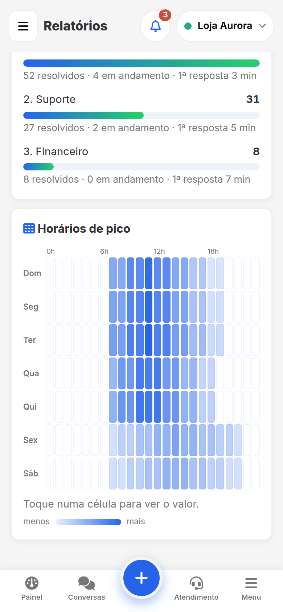

<p align="center">
  
</p>

<h1 align="center">ZapZap — Painel de WhatsApp do Alequizão</h1>

<p align="center">
  Conversas, atendimento em filas, campanhas, automações, chatbot e relatórios em um só painel —<br>
  <b>feito para o celular</b>, com várias conexões de WhatsApp, usuários com permissões e notificações com som e vibração.
</p>

<p align="center">
  
  
  
  
  
  
</p>

---

## ✨ Destaques

<table>
  <tr>
    <td width="33%" align="center"><br><b>Painel ao vivo</b><br><sub>Cards clicáveis, gráfico dos últimos 7 dias e atividade recente.</sub></td>
    <td width="33%" align="center"><br><b>Conversas completas</b><br><sub>Mídia, áudio, "digitando…", respostas rápidas, etiquetas e notas.</sub></td>
    <td width="33%" align="center"><br><b>Atendimento em filas</b><br><sub>Assumir, transferir, encerrar e cores pelo tempo sem resposta.</sub></td>
  </tr>
  <tr>
    <td align="center"><br><b>Automações</b><br><sub>Gatilhos, condições e ações, com modo TESTE e simulador.</sub></td>
    <td align="center"><br><b>Chatbot de menus</b><br><sub>Editor visual e simulador em formato de conversa.</sub></td>
    <td align="center"><br><b>Campanhas com freio</b><br><sub>Limites anti-bloqueio, janela de horário e confirmação forte.</sub></td>
  </tr>
  <tr>
    <td align="center"><br><b>Usuários e permissões</b><br><sub>Administrador libera cada recurso e cada conexão.</sub></td>
    <td align="center"><br><b>Relatórios</b><br><sub>KPIs com variação, gráficos, ranking e mapa de horários.</sub></td>
    <td align="center"><br><b>Notificações profissionais</b><br><sub>Som, vibração, não perturbe e push com o app fechado.</sub></td>
  </tr>
</table>

## 📱 O que o painel faz

| Área | Recursos |
|---|---|
| **Conexões** | Vários WhatsApps (instâncias da Evolution); QR Code ou código de pareamento; sincronização completa do histórico ao conectar; ao desconectar: manter, **ocultar** ou **apagar** os dados do número; alerta por e-mail quando cair |
| **Conversas** | Lista ao vivo, mídia sob demanda, gravação de áudio, "digitando…/gravando áudio…", marcar como lida automaticamente, citação, respostas rápidas (`/atalho`), etiquetas, notas internas, "me lembre de responder" |
| **Atendimento** | Filas com horário e saudação, status *aguardando / em atendimento / resolvido*, "atendido por", transferir, encerrar, **cores de SLA** pelo tempo sem resposta, painel "Meus atendimentos" |
| **Envio** | Texto, mídia, enquete, localização e contato; verificação de número; agendamento (com cron) |
| **Automações e chatbot** | Respostas por palavra-chave/horário/contato novo, mensagens agendadas, webhooks; fluxos de menu numerado; tudo nasce em **modo TESTE** (só registra, não envia) |
| **Campanhas** | Listas por CSV/colagem, variáveis `{nome}`, intervalo aleatório, limite diário, janela de horário, opt-out ("SAIR"), pausa automática em falhas |
| **Gestão** | Usuários e permissões por recurso e por conexão, **assinatura obrigatória** com o nome de quem envia, auditoria completa por usuário, relatórios e histórico exportáveis em CSV |
| **Integrações** | Tokens de API com escopos e limite, API pública para outros sistemas, webhooks de saída assinados (HMAC) |
| **Experiência** | PWA instalável, menu que desliza no celular, feedback visual em tudo, atualização forçada sem recarregar na mão, manual embutido (página **Ajuda**) |

> 📖 **Manual completo, com passo a passo e imagens:** [`docs/MANUAL.md`](docs/MANUAL.md) · 🛠️ **Instalação:** [`docs/INSTALACAO.md`](docs/INSTALACAO.md) · 🧱 **Arquitetura:** [`docs/ARQUITETURA.md`](docs/ARQUITETURA.md)

## 🧰 Tecnologia

- **Back-end:** PHP 8.3 sem Composer · MySQL 5.7+ (migrações automáticas) · integração com a [Evolution API](https://doc.evolution-api.com) v2.3
- **Front-end:** JavaScript puro (sem build), CSS próprio com variáveis, Font Awesome, Chart.js, tema Inter
- **Tempo real:** *polling* inteligente (pausa com a aba oculta) + webhook da Evolution
- **Segurança:** sessões no servidor com revogação, CSRF, limite de tentativas de login, permissões *default-deny*, hash bcrypt, proteção contra SSRF nos webhooks, CSP e cabeçalhos de segurança

## 🚀 Começando

```bash
# 1) copie o código e carimbe a versão
./deploy.exemplo.sh /var/www/zapzap

# 2) crie o banco, copie config.exemplo.php para a pasta privada e preencha
# 3) agende o cron (veja docs/INSTALACAO.md) e abra https://seu-dominio.com/zapzap/
```

No primeiro acesso, o usuário administrador é criado com uma **senha aleatória** gravada em `PRIMEIRA_SENHA.txt` (na pasta privada) — apague o arquivo depois de entrar. Guia completo em [`docs/INSTALACAO.md`](docs/INSTALACAO.md).

## 🗺️ Mapa do código

O repositório traz um **grafo de conhecimento** do código gerado com o [Graphify](https://github.com/Graphify-Labs/graphify): módulos, funções, tabelas e documentos, e como se ligam.

- [`graphify-out/graph.html`](graphify-out/graph.html) — grafo interativo ([abrir no navegador](https://raw.githack.com/alequizao/zapzap/main/graphify-out/graph.html))
- [`graphify-out/GRAPH_REPORT.md`](graphify-out/GRAPH_REPORT.md) — relatório: hubs, comunidades, conexões surpreendentes e perguntas sugeridas
- [`graphify-out/graph.json`](graphify-out/graph.json) — dados brutos (para `graphify query`, `path`, `explain`, `affected`)

Para regenerar: `uv tool install graphifyy && graphify install`, depois `/graphify .` no assistente (ou `graphify update .` só para o que mudou).

## ⚠️ Avisos importantes

- O painel usa a **Evolution API** (conexão não oficial via WhatsApp Web). O WhatsApp pode **restringir ou banir** números que enviem mensagens em massa ou sem consentimento. Use limites conservadores, respeite o opt-out e a LGPD.
- Toda mensagem enviada por um usuário sai **assinada com o nome dele** (regra do projeto, sem opção de desligar).
- Todas as imagens deste repositório usam **dados fictícios**.

## 📄 Licença

[MIT](LICENSE) — use, adapte e compartilhe.

---

<p align="center">Desenvolvido por <a href="https://instagram.com/alequizao">Alequizão</a></p>
