<p align="center"></p>

# Manual do ZapZap

Passo a passo completo, com imagens, de todas as telas do painel. As imagens usam **dados fictícios** (nomes como "Maria Souza" e "Loja Aurora"); no seu painel aparecem os seus dados.

> **Dica:** dentro do próprio painel existe a página **Ajuda** (menu lateral) com este mesmo conteúdo, busca por palavra e o botão para abrir o tutorial em tela cheia.

## Sumário

- [1. Primeiros passos](#1-primeiros-passos)
  - [Entrar no painel](#entrar-no-painel)
  - [Trocar a senha no primeiro acesso (quando o administrador exigir)](#trocar-a-senha-no-primeiro-acesso-quando-o-administrador-exigir)
  - [Instalar o painel como aplicativo](#instalar-o-painel-como-aplicativo)
  - [Usar o menu e navegar](#usar-o-menu-e-navegar)
  - [Trocar de conexão (de WhatsApp)](#trocar-de-conexão-de-whatsapp)
  - [Central de notificações (sino)](#central-de-notificações-sino)
  - [Preferências de notificação: som, vibração e não perturbe](#preferências-de-notificação-som-vibração-e-não-perturbe)
  - [Conhecer o Painel (página inicial)](#conhecer-o-painel-página-inicial)
- [2. Conectar um WhatsApp](#2-conectar-um-whatsapp)
  - [Ver as conexões](#ver-as-conexões)
  - [Conectar um novo número](#conectar-um-novo-número)
  - [Conectar lendo o QR Code](#conectar-lendo-o-qr-code)
  - [Conectar com código de pareamento](#conectar-com-código-de-pareamento)
  - [Sincronização completa dos dados](#sincronização-completa-dos-dados)
  - [Desconectar, ocultar ou apagar os dados](#desconectar-ocultar-ou-apagar-os-dados)
  - [Excluir uma conexão](#excluir-uma-conexão)
  - [Aviso por e-mail quando a conexão cai](#aviso-por-e-mail-quando-a-conexão-cai)
- [3. Conversas](#3-conversas)
  - [Ver a lista de conversas](#ver-a-lista-de-conversas)
  - [Ler e responder mensagens](#ler-e-responder-mensagens)
  - [Respostas assinadas](#respostas-assinadas)
  - [Enviar fotos, documentos e outros arquivos](#enviar-fotos-documentos-e-outros-arquivos)
  - [Gravar e enviar áudio](#gravar-e-enviar-áudio)
  - [Marcar como lida](#marcar-como-lida)
  - [Respostas rápidas com a barra "/"](#respostas-rápidas-com-a-barra-)
  - [Etiquetas na conversa](#etiquetas-na-conversa)
  - [Notas internas](#notas-internas)
  - [Lembrar de responder](#lembrar-de-responder)
  - [Enviar para outro número](#enviar-para-outro-número)
- [4. Atendimento e filas](#4-atendimento-e-filas)
  - [Entender a tela Atendimento](#entender-a-tela-atendimento)
  - [Cores de espera (SLA)](#cores-de-espera-sla)
  - [Assumir um atendimento](#assumir-um-atendimento)
  - [Transferir um atendimento](#transferir-um-atendimento)
  - [Encerrar e reabrir](#encerrar-e-reabrir)
  - [Criar um atendimento manualmente](#criar-um-atendimento-manualmente)
  - [Receber atendimentos sozinhos (tempo real)](#receber-atendimentos-sozinhos-tempo-real)
  - [Criar e editar filas](#criar-e-editar-filas)
  - [Horário de atendimento da fila](#horário-de-atendimento-da-fila)
- [5. Enviar](#5-enviar)
  - [Escolher o destinatário](#escolher-o-destinatário)
  - [Verificar se o número tem WhatsApp](#verificar-se-o-número-tem-whatsapp)
  - [Enviar texto](#enviar-texto)
  - [Enviar mídia](#enviar-mídia)
  - [Enviar enquete](#enviar-enquete)
  - [Enviar localização](#enviar-localização)
  - [Enviar contato](#enviar-contato)
  - [Agendar o envio](#agendar-o-envio)
- [6. Agendadas](#6-agendadas)
  - [Acompanhar as mensagens agendadas](#acompanhar-as-mensagens-agendadas)
  - [Enviar agora, reagendar ou cancelar](#enviar-agora-reagendar-ou-cancelar)
- [7. Automações](#7-automações)
  - [O que são automações](#o-que-são-automações)
  - [Criar uma automação a partir de um modelo](#criar-uma-automação-a-partir-de-um-modelo)
  - [Escolher o gatilho (Quando)](#escolher-o-gatilho-quando)
  - [Definir as condições](#definir-as-condições)
  - [Escolher as ações (Então)](#escolher-as-ações-então)
  - [Testar no simulador](#testar-no-simulador)
  - [Modo TESTE ou AO VIVO](#modo-teste-ou-ao-vivo)
  - [Ligar o recebimento em tempo real](#ligar-o-recebimento-em-tempo-real)
  - [Acompanhar os registros](#acompanhar-os-registros)
  - [Duplicar e excluir](#duplicar-e-excluir)
- [8. Chatbot](#8-chatbot)
  - [O que é o chatbot](#o-que-é-o-chatbot)
  - [Criar um fluxo a partir de um modelo](#criar-um-fluxo-a-partir-de-um-modelo)
  - [Montar as etapas do fluxo](#montar-as-etapas-do-fluxo)
  - [Testar no simulador](#testar-no-simulador-1)
  - [Ativar, modo TESTE x AO VIVO](#ativar-modo-teste-x-ao-vivo)
  - [Acompanhar as sessões](#acompanhar-as-sessões)
- [9. Campanhas e listas](#9-campanhas-e-listas)
  - [Antes de começar: limites anti-bloqueio](#antes-de-começar-limites-anti-bloqueio)
  - [Criar uma lista de contatos](#criar-uma-lista-de-contatos)
  - [Adicionar contatos à lista](#adicionar-contatos-à-lista)
  - [Opt-out (quem pede para sair)](#opt-out-quem-pede-para-sair)
  - [Criar uma campanha (assistente em 4 passos)](#criar-uma-campanha-assistente-em-4-passos)
  - [Confirmar e iniciar o envio](#confirmar-e-iniciar-o-envio)
  - [Acompanhar, pausar e cancelar](#acompanhar-pausar-e-cancelar)
- [10. Contatos, grupos, respostas rápidas, etiquetas e notas](#10-contatos-grupos-respostas-rápidas-etiquetas-e-notas)
  - [Buscar contatos e iniciar uma conversa](#buscar-contatos-e-iniciar-uma-conversa)
  - [Verificar se um número tem WhatsApp](#verificar-se-um-número-tem-whatsapp)
  - [Ver grupos e copiar o link de convite](#ver-grupos-e-copiar-o-link-de-convite)
  - [Criar respostas rápidas](#criar-respostas-rápidas)
  - [Usar uma resposta rápida numa conversa](#usar-uma-resposta-rápida-numa-conversa)
  - [Organizar com etiquetas](#organizar-com-etiquetas)
  - [Registrar notas internas](#registrar-notas-internas)
- [11. Relatórios](#11-relatórios)
  - [Ler os números do período](#ler-os-números-do-período)
  - [Gráfico, ranking e horários de pico](#gráfico-ranking-e-horários-de-pico)
  - [Exportar relatórios em CSV](#exportar-relatórios-em-csv)
- [12. Histórico](#12-histórico)
  - [Consultar e filtrar envios](#consultar-e-filtrar-envios)
  - [Ver se a mensagem foi entregue e lida](#ver-se-a-mensagem-foi-entregue-e-lida)
  - [Exportar o histórico](#exportar-o-histórico)
- [13. Integrações (API e webhooks)](#13-integrações-api-e-webhooks)
  - [Criar um token de API](#criar-um-token-de-api)
  - [Acompanhar o uso e revogar um token](#acompanhar-o-uso-e-revogar-um-token)
  - [Chamar a API pública](#chamar-a-api-pública)
  - [Receber avisos com webhooks de saída](#receber-avisos-com-webhooks-de-saída)
- [14. Usuários e permissões](#14-usuários-e-permissões)
  - [Criar um usuário](#criar-um-usuário)
  - [Usar perfis rápidos e ajustar permissões](#usar-perfis-rápidos-e-ajustar-permissões)
  - [Liberar conexões](#liberar-conexões)
  - [Gerar ou redefinir a senha de um usuário](#gerar-ou-redefinir-a-senha-de-um-usuário)
  - [Ver a atividade e as sessões de um usuário](#ver-a-atividade-e-as-sessões-de-um-usuário)
  - [Desativar ou excluir um usuário](#desativar-ou-excluir-um-usuário)
- [15. Auditoria](#15-auditoria)
  - [Consultar o registro de atividades](#consultar-o-registro-de-atividades)
  - [Entender o alerta de falhas de login](#entender-o-alerta-de-falhas-de-login)
- [16. Configurações](#16-configurações)
  - [Ajustar o comportamento da conexão](#ajustar-o-comportamento-da-conexão)
  - [Mudar o nome e o recado do perfil](#mudar-o-nome-e-o-recado-do-perfil)
  - [Trocar a sua senha](#trocar-a-sua-senha)
  - [Instalar o app e forçar atualização](#instalar-o-app-e-forçar-atualização)
  - [Reiniciar a conexão](#reiniciar-a-conexão)
  - [Consultar o histórico de versões](#consultar-o-histórico-de-versões)
- [17. Dúvidas frequentes e solução de problemas](#17-dúvidas-frequentes-e-solução-de-problemas)
  - [O QR Code não aparece ou expirou](#o-qr-code-não-aparece-ou-expirou)
  - [A mensagem não chega ao destinatário](#a-mensagem-não-chega-ao-destinatário)
  - [O número não tem o nono dígito](#o-número-não-tem-o-nono-dígito)
  - [Aparece "sem permissão" ou falta uma tela no menu](#aparece-sem-permissão-ou-falta-uma-tela-no-menu)
  - [Esqueci a minha senha](#esqueci-a-minha-senha)
  - [Não escuto o som das notificações no iPhone](#não-escuto-o-som-das-notificações-no-iphone)
  - [O painel pediu para atualizar sozinho](#o-painel-pediu-para-atualizar-sozinho)
  - [Desconectei sem querer ou a conexão ficou vermelha](#desconectei-sem-querer-ou-a-conexão-ficou-vermelha)
- [18. Glossário](#18-glossário)
  - [Glossário](#glossário)

---

## 1. Primeiros passos

### Entrar no painel

O ZapZap é um painel para usar o WhatsApp do computador ou do celular. Cada pessoa entra com o seu próprio usuário e senha.

1. Abra o endereço do painel no navegador (o administrador informa o link).
2. Digite o seu **Usuário** e a sua **Senha**. Toque no olho para ver a senha que está digitando.
3. Toque em **Entrar**.
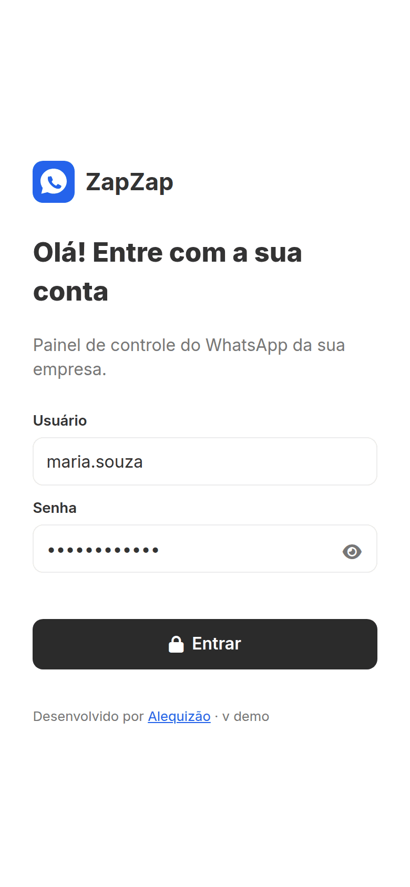
4. Pronto: você cai na página **Painel**, a página inicial, com o resumo do dia.
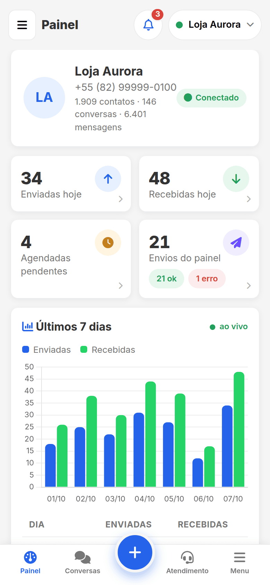

> **Dica:** se errar a senha várias vezes seguidas, o painel pede para aguardar alguns minutos antes de tentar de novo.

### Trocar a senha no primeiro acesso (quando o administrador exigir)

A senha que o administrador cria ou gera para você é definitiva: você pode usá-la normalmente. Só se ele marcar a opção **Exigir que a pessoa troque a senha no primeiro acesso** o painel não deixa você continuar sem criar uma senha só sua.

1. Entre com a senha que o administrador passou.
2. Na janela **Defina a sua senha**, digite essa senha no primeiro campo (a que você usou para entrar).
3. Digite a **Nova senha (mínimo 6 caracteres)** e repita em **Repita a nova senha**.
4. Toque em **Salvar nova senha**.
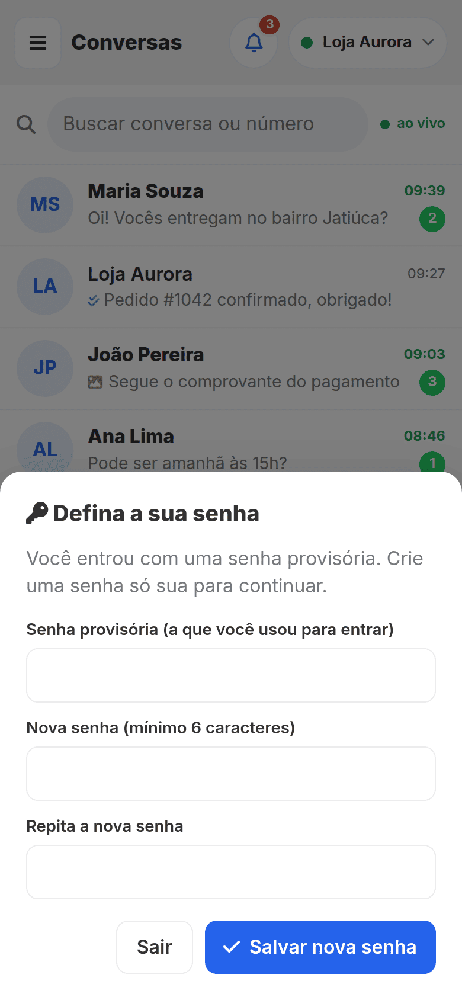

> **Atenção:** a nova senha precisa ter pelo menos 6 caracteres e ser diferente da anterior. Se você tocar em **Sair**, a janela volta no próximo acesso.
> **Dica:** mesmo sem essa exigência, você pode trocar a senha quando quiser em **Configurações**.

### Instalar o painel como aplicativo

O painel funciona como um aplicativo: abre em tela cheia, com ícone próprio, sem a barra do navegador.

1. No menu lateral (veja o tópico seguinte), role até o rodapé e toque em **Instalar aplicativo**. O botão só aparece quando o aparelho permite instalar.
2. **No Android (Chrome):** confirme a instalação na janela que o navegador mostra.
3. **No iPhone (Safari):** aparece o aviso **Instalar no iPhone**. Toque em **Compartilhar** e depois em **Adicionar à Tela de Início**.
4. Abra o ZapZap pelo novo ícone na tela inicial.

> **Dica:** o painel se atualiza sozinho. Quando sai uma versão nova, aparece o aviso **Atualizando…** por alguns segundos e a tela recarrega.

### Usar o menu e navegar

No celular há uma barra de atalhos na parte de baixo e um menu lateral com todas as telas.

1. Na barra de baixo estão as telas mais usadas: **Painel**, **Conversas**, o botão redondo **+** (que abre o **Enviar**), **Atendimento** e **Menu**.
2. Toque em **Menu** (ou no botão de três riscos no canto superior esquerdo) para abrir a lista completa de telas.
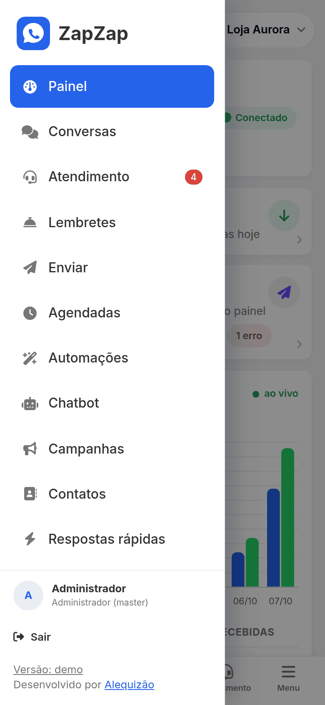
3. Você também pode **deslizar o dedo da borda esquerda da tela para a direita** para abrir o menu, e deslizar para a esquerda para fechá-lo.
4. No fim do menu ficam o seu nome, o botão **Sair** e a versão do painel.

> **Dica:** você só vê no menu as telas que o administrador liberou para o seu usuário. Se faltar alguma, peça a ele.

> **Atenção:** dentro de uma conversa aberta no celular o gesto de deslizar fica desligado, para não atrapalhar. Use o botão de voltar da conversa.

### Trocar de conexão (de WhatsApp)

Um mesmo painel pode ter vários números de WhatsApp (cada um é uma "conexão"). Tudo o que você vê — conversas, contatos, agendadas — pertence à conexão ativa.

1. No topo da tela, toque no botão com o nome da conexão e uma bolinha de cor (verde = conectada, vermelha = desconectada).
2. Na janela **Seus WhatsApps**, toque na conexão que deseja usar.
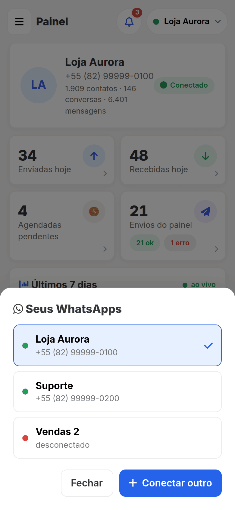
3. O painel recarrega a tela atual com os dados da nova conexão e mostra o aviso **Conexão: nome**.
4. Para adicionar outro número, toque em **Conectar outro** (veja a seção 2).

### Central de notificações (sino)

O sino no topo avisa sobre mensagens novas, atendimentos, agendamentos, campanhas, conexão e automações.

1. Quando há novidade, o sino mostra um número vermelho.
2. Para mensagens que chegam enquanto você usa o painel, aparece um banner rápido no alto da tela. Toque nele para ir direto à conversa.
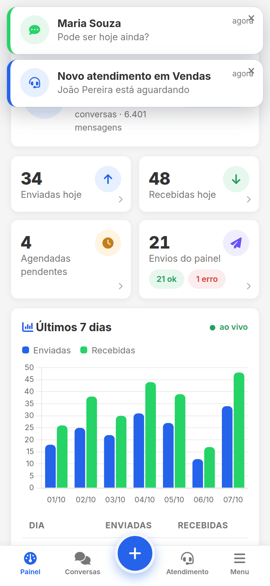
3. Toque no sino para abrir a central **Notificações**. Use as abas **Todas**, **Mensagens** e **Alertas** para filtrar.
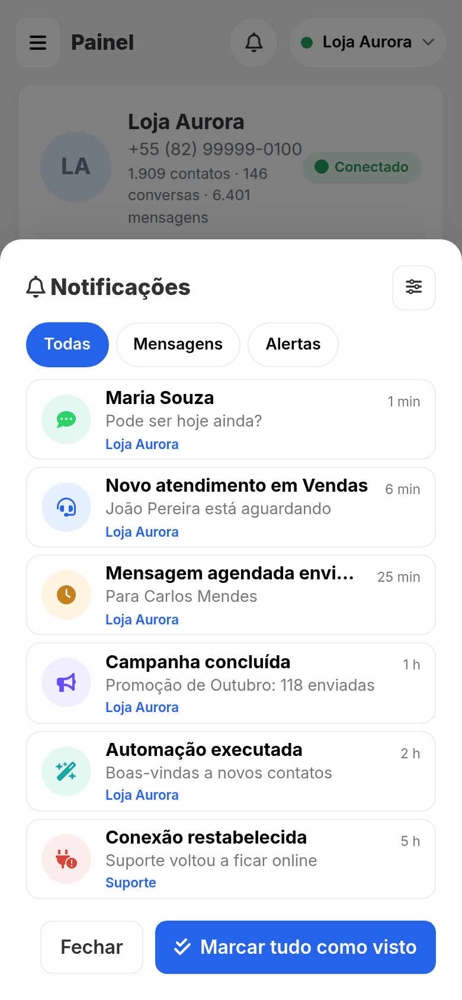
4. Toque em um aviso para ir à tela correspondente.
5. Toque em **Marcar tudo como visto** para zerar o contador.

### Preferências de notificação: som, vibração e não perturbe

Cada pessoa ajusta os avisos do seu próprio aparelho.

1. Abra o sino e toque no botão de controles (**Preferências**) no canto superior direito.
2. Ligue ou desligue **Efeito sonoro**, ajuste o **Volume** e escolha o tom: **Sino**, **Gota**, **Suave**, **Pulso** ou **Alerta** (toque para ouvir).
3. Ligue **Vibração (celulares compatíveis)** se quiser que o aparelho vibre.
4. Ligue **Notificação do navegador (com a aba em segundo plano)** para receber avisos mesmo com o painel em outra aba. O navegador pede a sua permissão.
5. Ligue **Não perturbe** e escolha o horário (**Das** ... **até**) em que os avisos devem ficar quietos.
6. Em **Avisar sobre**, marque só os tipos que importam para você.
7. Toque em **Testar** para simular um aviso e em **Pronto** para fechar.
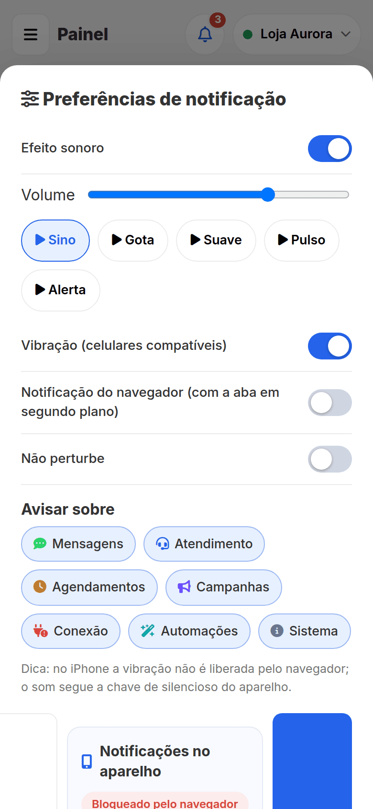

> **Dica:** no iPhone o navegador não libera a vibração, e o som segue a chave de silencioso do aparelho.

### Conhecer o Painel (página inicial)

O Painel mostra, de relance, como está o dia da conexão ativa.

1. No alto, o cartão do perfil mostra a foto, o nome, o número e o selo **Conectado** (ou **Desconectado**).
2. Os quatro cartões mostram **Enviadas hoje**, **Recebidas hoje**, **Agendadas pendentes** e **Envios do painel** (com quantos deram certo e quantos deram erro).
3. O gráfico **Últimos 7 dias** compara mensagens enviadas (azul) e recebidas (verde); logo abaixo há a tabela com os mesmos números.
4. Em **Atividade recente** toque numa linha para abrir a conversa.
5. Os atalhos **Enviar mensagem**, **Conversas** e **Agendar** levam direto às telas.

> **Dica:** o selo **ao vivo** indica que a tela se atualiza sozinha, a cada poucos segundos.

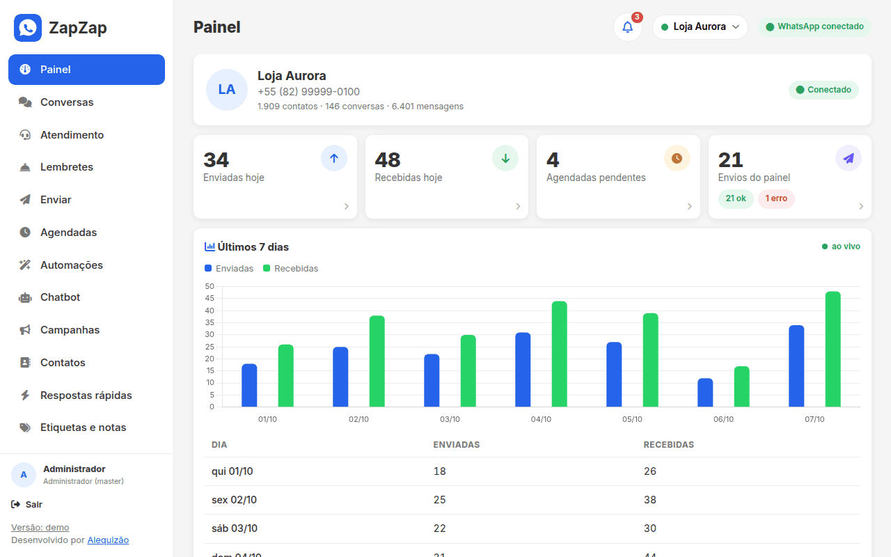

## 2. Conectar um WhatsApp

### Ver as conexões

A tela **Conexões** lista cada número ligado ao painel e permite conectar, sincronizar, renomear, desconectar e excluir.

1. Abra **Conexões** no menu.
2. Cada cartão mostra a foto, o apelido, o número, o estado (**Conectado**, **Conectando** ou **Desconectado**) e quantas mensagens, contatos e conversas existem.
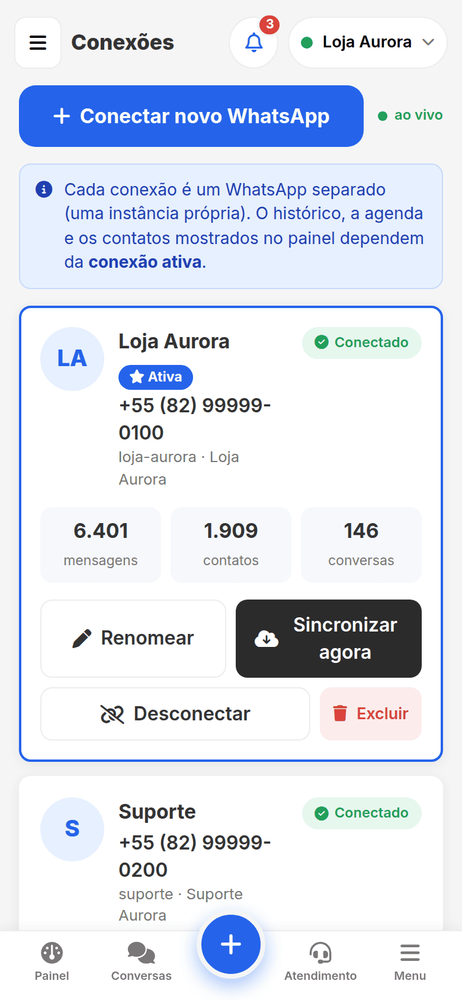
3. A conexão em uso tem o selo **Ativa**. Em outra conexão, toque em **Usar esta** para torná-la ativa.
4. Toque em **Renomear** para mudar o apelido (até 40 caracteres), por exemplo "Loja Aurora".

> **Dica:** conexões com o cadeado são **protegidas**: o painel não permite desconectá-las nem excluí-las.

### Conectar um novo número
> **Administrador**

Para cada número novo, crie uma conexão e leia um QR Code com o celular.

1. Em **Conexões**, toque em **Conectar novo WhatsApp**.
2. Preencha o **Apelido** (por exemplo, "WhatsApp da loja"). O **Nome técnico** é sugerido automaticamente e aceita só letras, números, "-" e "_" (2 a 40 caracteres).
3. Toque em **Criar**. O painel avisa **Conexão criada. Leia o QR Code.** e abre a tela de leitura.
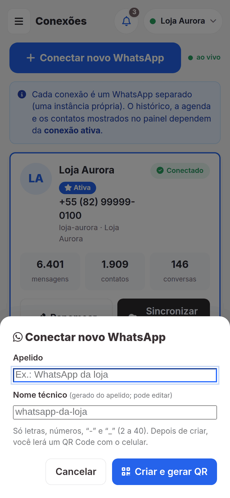

### Conectar lendo o QR Code
> **Administrador**

O QR Code liga o painel ao WhatsApp do seu celular, do mesmo jeito que o WhatsApp Web.

1. Em um cartão desconectado, toque em **Conectar / Gerar QR**.
2. No celular, abra o **WhatsApp**, vá em **Configurações**, **Aparelhos conectados** e **Conectar um aparelho**.
3. Aponte a câmera para o QR Code da tela do painel.
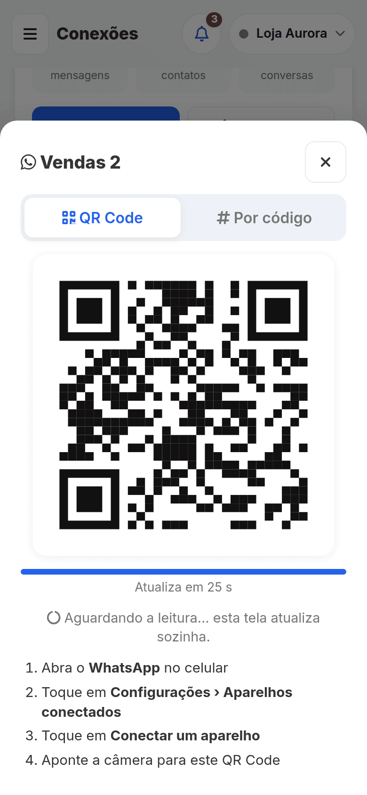
4. A tela mostra **Aguardando a leitura…** e atualiza sozinha. Quando conecta, aparece **Conectado!** com uma animação de confirmação.
5. Toque em **Usar esta conexão** para trabalhar com ela agora, ou em **Fechar**.

> **Dica:** o QR Code vale por cerca de 25 segundos; uma barra mostra o tempo e um novo código é gerado automaticamente. Se der erro, toque em **Tentar de novo**.

### Conectar com código de pareamento
> **Administrador**

Se você não consegue apontar a câmera (por exemplo, está no mesmo celular), use o código.

1. Na tela do QR, toque na aba **Por código**.
2. Digite o número do WhatsApp com DDI e DDD (exemplo: 5582999990001) e toque em **Gerar código**.
3. No WhatsApp do celular, vá em **Aparelhos conectados**, **Conectar um aparelho** e escolha **Conectar com número de telefone**.
4. Digite o código de oito caracteres mostrado na tela do painel.
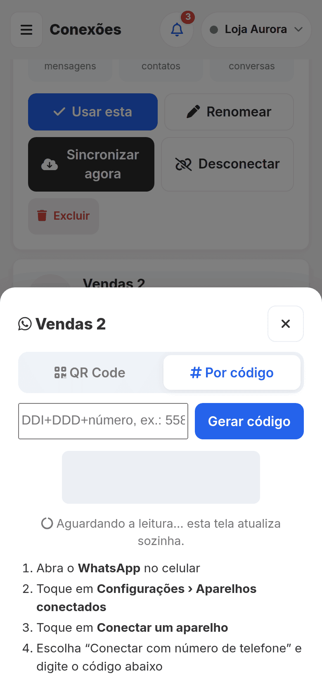

### Sincronização completa dos dados
> **Administrador**

Ao conectar, o painel baixa os dados do número para mostrar contatos, grupos e histórico.

1. Logo após conectar, a janela **Baixando seus dados…** mostra as etapas: **Perfil e recado**, **Contatos e fotos**, **Grupos**, **Conversas**, **Histórico de mensagens** e **Mídias**, com barra de progresso.
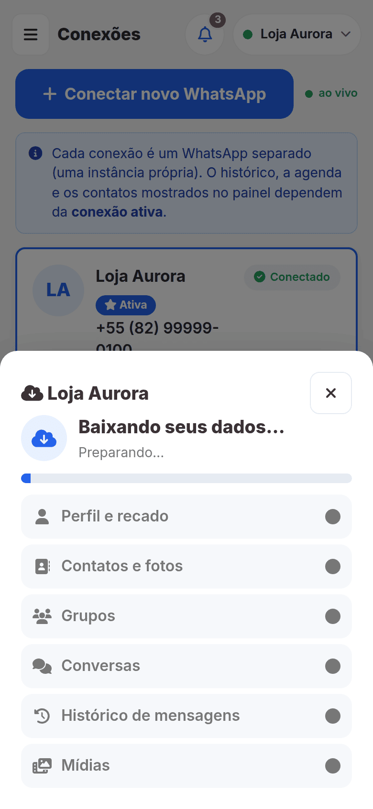
2. No fim aparece o resumo com a quantidade de contatos, grupos, conversas e mensagens.
3. Se quiser, escolha **últimos 7 dias**, **15 dias** ou **30 dias** e toque em **Baixar também as mídias** para trazer fotos, vídeos, áudios e documentos recentes (até 500 MB, em segundo plano). Dá para tocar em **Cancelar download**.
4. Em qualquer momento, com a conexão ativa, toque em **Sincronizar agora** no cartão para repetir o processo.

### Desconectar, ocultar ou apagar os dados
> **Administrador**

Ao desconectar (ou limpar) um número, você decide o que acontece com os dados dele no painel.

1. No cartão da conexão, toque em **Desconectar** (se estiver conectada) ou **Limpar dados** (se já estiver desconectada).
2. Escolha uma das opções:
   - **Manter dados:** só desconecta o WhatsApp; mensagens, contatos e grupos continuam aparecendo.
   - **Ocultar dados (recomendado para trocar de número):** o painel passa a mostrar só o que chegar depois, nada é apagado do servidor.
   - **Apagar tudo:** apaga mensagens, contatos e registros da conexão e a recria zerada; não dá para desfazer. Para liberar, digite o nome técnico da conexão.
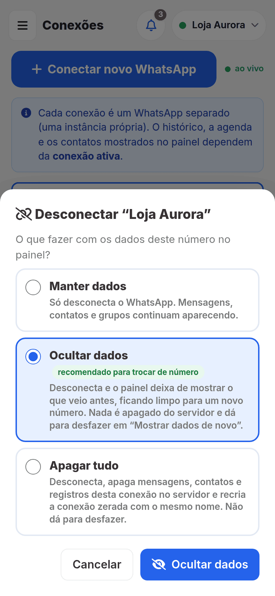
3. Confirme no aviso que aparece.
4. Se escolheu **Ocultar dados**, o cartão mostra **Dados ocultos** e o botão **Mostrar dados de novo** desfaz a ocultação.

> **Atenção:** **Apagar tudo** é irreversível. Prefira **Ocultar dados** quando estiver só trocando de número.

### Excluir uma conexão
> **Administrador**

1. No cartão da conexão, toque em **Excluir**.
2. Leia o aviso e digite o nome da conexão para confirmar.
3. Toque no botão vermelho para concluir. O painel mostra **Conexão excluída**.

> **Atenção:** a exclusão é definitiva e não está disponível para conexões protegidas (com cadeado).

### Aviso por e-mail quando a conexão cai

O painel confere o estado de todas as conexões a cada minuto. Quando uma cai (ou volta a funcionar), ele manda um e-mail de aviso ao responsável técnico e registra uma notificação na central (sino).

1. Se aparecer **Desconectado** no topo ou no cartão, abra **Conexões**.
2. Toque em **Conectar / Gerar QR** e leia o código de novo.
3. Quando voltar, o painel avisa que a conexão foi restabelecida.

> **Dica:** para evitar repetição, o aviso por e-mail não é reenviado para a mesma conexão em menos de 30 minutos.

## 3. Conversas

### Ver a lista de conversas

A tela **Conversas** mostra todas as conversas da conexão ativa, da mais recente para a mais antiga.

1. Abra **Conversas** na barra de baixo.
2. Cada linha mostra a foto (ou as iniciais), o nome, a prévia da última mensagem, a hora e um contador de mensagens não lidas.
3. Use o campo **Buscar conversa ou número** para filtrar.
4. Quando alguém está digitando ou gravando áudio, a prévia mostra "digitando…" ou "gravando áudio".
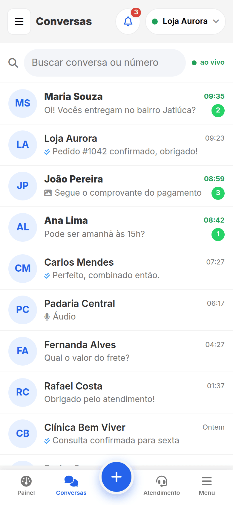
5. Toque numa conversa para abri-la. No computador, a lista fica à esquerda e a conversa à direita.
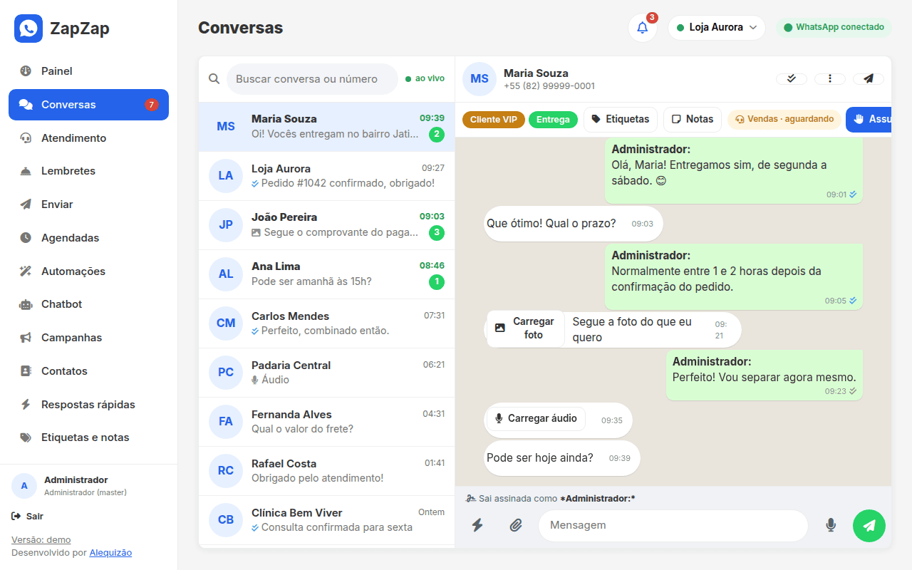

> **Dica:** o selo **ao vivo** mostra que a lista se atualiza sozinha.

### Ler e responder mensagens

Dentro da conversa, as mensagens aparecem em ordem, com a marca de entrega.

1. Role para cima e toque em **Carregar mais** para ver mensagens antigas.
2. Quando chegarem mensagens novas e você estiver lendo o histórico, aparece o botão **Novas mensagens**; toque nele para descer.
3. Digite no campo **Digite uma mensagem** e toque no botão de avião de papel para enviar.
4. Acompanhe a marca de cada mensagem: enviando, enviada, entregue, lida (azul) ou falhou — nas que falharem há a opção de reenviar.
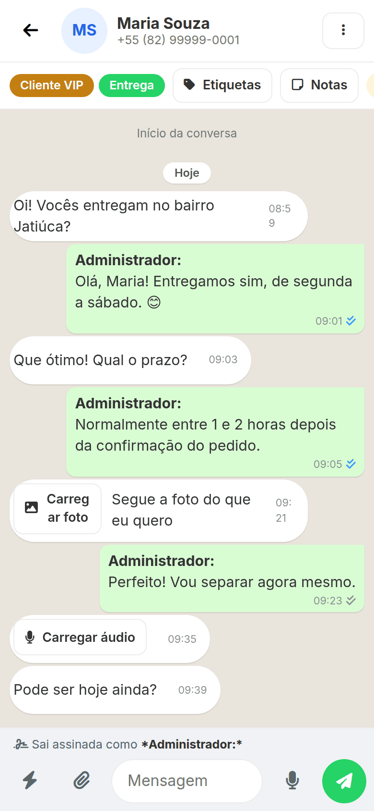

> **Atenção:** o limite de uma mensagem é de 4096 caracteres.

### Respostas assinadas

Toda mensagem enviada por um usuário sai com o nome dele, para o cliente saber quem está falando.

1. Acima do campo de mensagem aparece a linha **Sai assinada como** seguida do seu nome entre asteriscos e dois pontos.
2. Escreva normalmente: o painel acrescenta a assinatura na primeira linha.
3. A assinatura vale também para legendas de mídia, enquetes, localização e mensagens agendadas.

> **Atenção:** não existe opção para desligar a assinatura. Mensagens automáticas (automações e chatbot) não levam assinatura.

### Enviar fotos, documentos e outros arquivos

1. Toque no clipe (**Anexar arquivo**) ao lado do campo de mensagem.
2. Escolha uma imagem, vídeo, áudio, PDF, Word, Excel, TXT ou ZIP de até 25 MB.
3. Aparece uma pré-visualização do arquivo. Digite uma **Legenda (opcional)** no campo de texto.
4. Toque no avião de papel para enviar. Para desistir, toque no X da pré-visualização.

> **Dica:** se o arquivo passar de 25 MB o painel avisa **Arquivo muito grande (máximo 25 MB)**.

### Gravar e enviar áudio

1. Com o campo de texto vazio, toque no microfone (**Gravar áudio**).
2. Permita o uso do microfone se o navegador pedir. A tela mostra o cronômetro e uma animação; a gravação vai até 5 minutos.
3. Toque no botão de enviar para parar a gravação. Aparece um player para você ouvir antes de decidir.
4. Toque em enviar para mandar o áudio, ou na lixeira (**Descartar áudio**) para jogar fora.

> **Dica:** enquanto você grava, o contato vê "gravando áudio" no WhatsApp dele; enquanto você digita, ele vê "digitando…".

### Marcar como lida

O painel nunca avisa o contato de leitura sem você querer: a marcação como lida é uma escolha sua.

1. Na conversa, toque em **Marcar como lida** (botão com dois tiques no topo; no celular fica no menu de três pontos).
2. O painel avisa **Conversa marcada como lida**.
3. No menu de três pontos há ainda o interruptor **Marcar como lida ao abrir**: ligado, toda conversa que você abrir é marcada como lida automaticamente.

### Respostas rápidas com a barra "/"

Respostas rápidas são textos prontos que você chama por um atalho (veja a seção Respostas rápidas na tela do mesmo nome).

1. No campo de mensagem, digite **/** seguido do atalho (por exemplo, **/horario**). Aparecem sugestões com o atalho e o texto.
2. Toque numa sugestão para colocar o texto no campo; revise e envie.
3. Ou toque no raio (**Respostas rápidas**) ao lado do clipe para abrir a lista completa e escolher uma resposta.
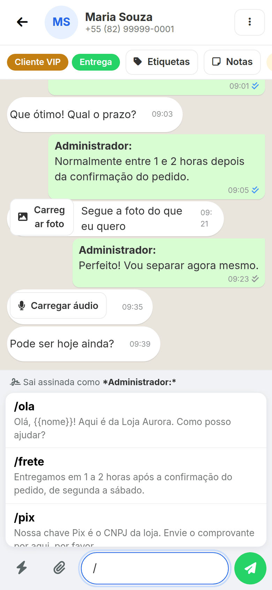

> **Dica:** os textos aceitam variáveis como **{nome}**, **{numero}**, **{saudacao}** e **{atendente}**, que o painel troca pelos dados reais.

### Etiquetas na conversa
> **Administrador**

Etiquetas são rótulos coloridos para organizar contatos (por exemplo, "Cliente", "Orçamento").

1. No cabeçalho da conversa, toque em **Etiquetas**.
2. Toque nas etiquetas que deseja aplicar ou retirar; as marcadas ficam destacadas e a janela mostra quantas estão marcadas.
3. Para criar uma etiqueta nova na hora, digite o nome em **Nova etiqueta…**, escolha uma cor e toque em **Criar** (ela já é aplicada à conversa).
4. Toque em **Pronto**. As etiquetas aparecem como chips no cabeçalho.
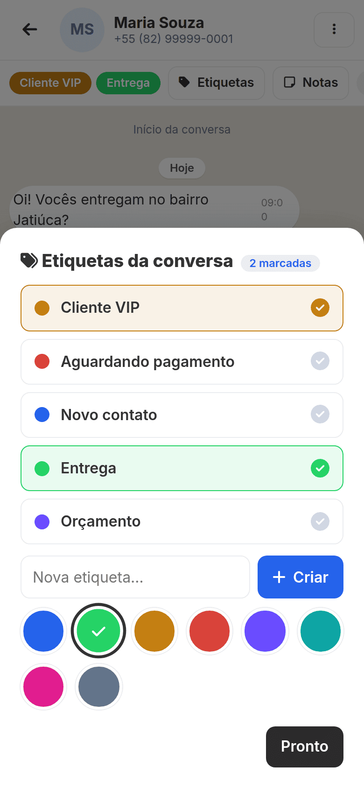

### Notas internas

Notas são anotações só da equipe: nunca vão para o cliente.

1. No cabeçalho da conversa, toque em **Notas**.
2. Escreva no campo **Escreva uma nota interna…** (até 2000 caracteres) e toque em **Adicionar nota**.
3. Use o alfinete para fixar uma nota importante no topo e a lixeira para excluir.
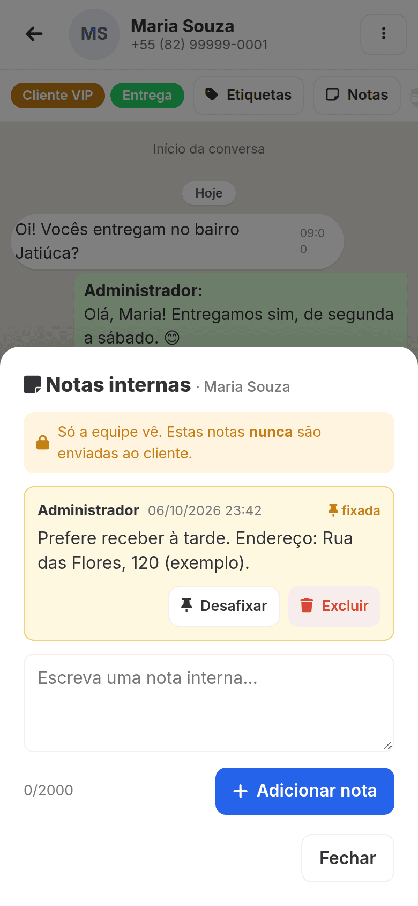

### Lembrar de responder

A tela **Lembretes** reúne os avisos "me lembre de responder". Cada lembrete avisa você, com som e vibração, se a conversa ainda não foi respondida.

1. Abra **Lembretes** no menu.
2. Use as abas **Pendentes**, **Avisados**, **Respondidos** e **Cancelados**.
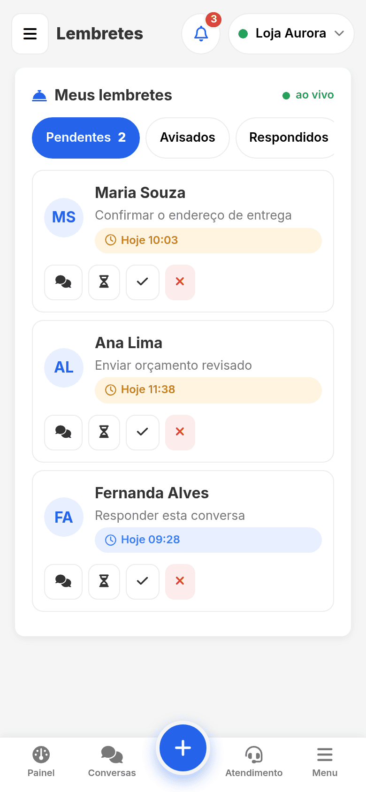
3. Em cada lembrete, toque no balão para abrir a conversa, na ampulheta para **Adiar 1 hora**, no visto para marcar **Já respondi** ou no X para cancelar.
4. Ao criar um lembrete você escolhe 15 min, 30 min, 1 hora, 2 horas, 4 horas, Hoje 18h, Amanhã 9h ou uma data e hora com **Escolher…**, e pode incluir uma anotação.

> **Atenção:** nesta versão a tela **Lembretes** e a janela **Me lembrar de responder** existem, mas não há um botão dentro da conversa que abra a janela de criação.

### Enviar para outro número

1. Dentro da conversa, toque em **Enviar para outro número** (ou no menu de três pontos).
2. Você vai para a tela **Enviar** (seção 5) para escolher o destinatário.

## 4. Atendimento e filas

### Entender a tela Atendimento

Atendimento organiza os clientes que escreveram em uma fila de espera, para que a equipe saiba quem já foi atendido e quem está esperando.

1. Abra **Atendimento** na barra de baixo.
2. As três abas mostram a contagem de cada situação: **Aguardando**, **Em atendimento** e **Resolvidos**. Toque para trocar.
3. As pílulas **Todas** e os nomes das filas filtram por fila.
4. O botão **Meus** mostra só os atendimentos que são seus; o sino liga e desliga o som de novo atendimento; **Novo** cria um atendimento; **Filas** abre a gestão das filas.
5. Cada cartão mostra o contato, a prévia da última mensagem, a fila, quem atende e há quanto tempo o cliente está sem resposta.
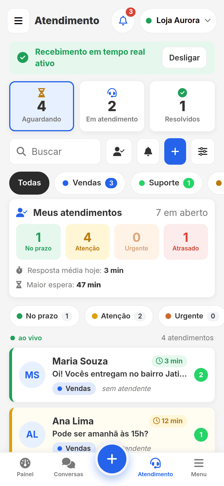

> **Dica:** no computador a tela fica mais larga, com os cartões lado a lado.

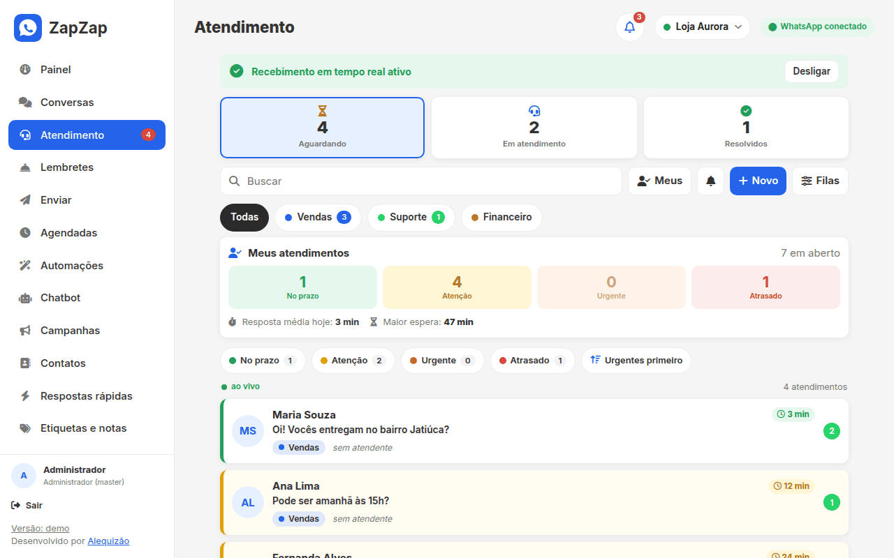

### Cores de espera (SLA)

O tempo sem resposta ganha cor para mostrar a urgência.

1. **No prazo** (verde): o cliente espera pouco.
2. **Atenção** (amarelo): a espera está crescendo.
3. **Urgente** (laranja): é hora de responder.
4. **Atrasado** (vermelho): passou de todos os limites e o cartão pulsa.
5. Toque em uma cor da legenda para ver só aquele grupo. **Urgentes primeiro** coloca na frente quem espera há mais tempo.
6. Os limites padrão são 5, 15 e 30 minutos; cada fila pode ter os seus.
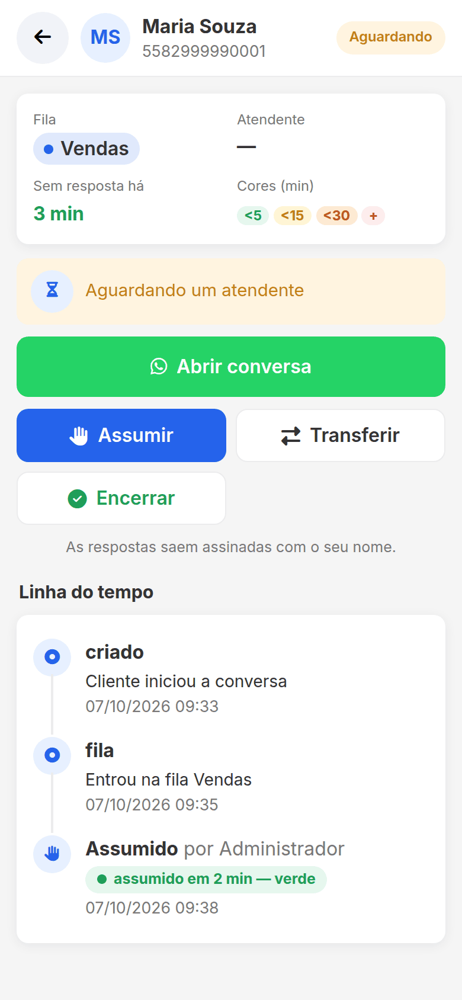

### Assumir um atendimento

1. Em **Aguardando**, toque no cartão para abrir o detalhe.
2. Toque em **Assumir**. O painel avisa **Você assumiu o atendimento** e ele passa para **Em atendimento**, no seu nome.
3. Toque em **Abrir conversa** para responder ao cliente. As respostas saem assinadas com o seu nome.
4. Dentro da própria conversa também aparecem os botões **Assumir**, **Transferir** e **Encerrar** quando o contato tem atendimento aberto.

> **Dica:** se outro atendente assumir primeiro, o painel avisa **Já assumido por** e atualiza a lista.

### Transferir um atendimento

1. No detalhe do atendimento (ou na conversa), toque em **Transferir**.
2. Escolha **Para a fila** e/ou **Para o atendente**. Se deixar o atendente em branco, o atendimento volta para a fila sem dono.
3. Escreva o **Motivo (opcional)**.
4. Toque em **Transferir**. O painel avisa **Atendimento transferido**.
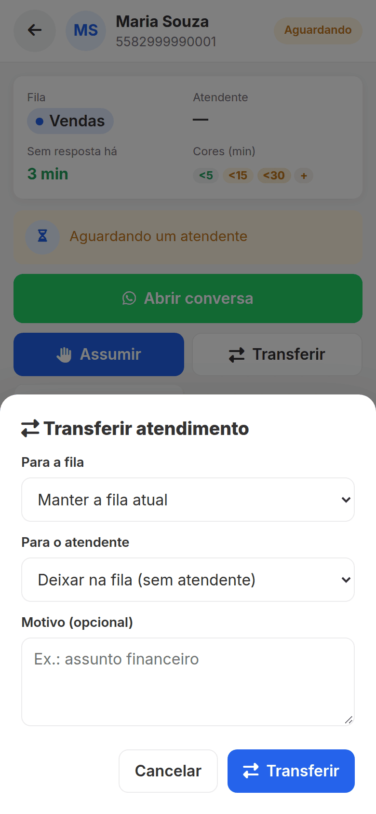

### Encerrar e reabrir

1. No detalhe do atendimento, toque em **Encerrar**.
2. Escreva um **Resumo do atendimento** (opcional) e confirme.
3. O atendimento vai para **Resolvidos**, com o resumo no detalhe.
4. Para voltar atrás, abra o atendimento resolvido e toque em **Reabrir**.
5. A **Linha do tempo** no detalhe registra tudo: criação, quem assumiu, transferências, encerramento e o tempo de resposta de cada etapa.

### Criar um atendimento manualmente

1. Toque em **Novo**.
2. Em **Contato**, busque por nome ou número e escolha o contato.
3. Escolha a **Fila** e toque em **Criar**.

### Receber atendimentos sozinhos (tempo real)
> **Administrador**

Para novos clientes entrarem na fila automaticamente, o recebimento em tempo real precisa estar ligado.

1. No topo da tela, o aviso mostra **Recebimento em tempo real desligado** ou **ativo**.
2. Quem tem permissão de gerir filas toca em **Ligar** (e confirma). Para parar, toque em **Desligar**.

> **Atenção:** desligar o recebimento em tempo real também para as Automações e o Chatbot desta conexão. O painel nunca liga isso sozinho.

### Criar e editar filas
> **Administrador**

1. Toque em **Filas** (**Gerir filas**) e depois em **Nova fila**. Para uma fila existente, toque no lápis; use as setas para mudar a ordem e a lixeira para excluir.
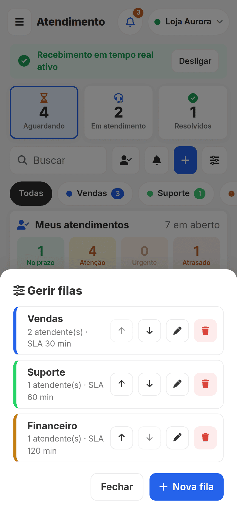
2. Preencha **Nome**, escolha a **Cor** e marque os **Atendentes da fila**.
3. Escreva a **Mensagem de saudação** (enviada quando o cliente entra na fila) e a **Mensagem de ausência (fora do horário)**.
4. Defina o **SLA — tempo máximo de espera (minutos, 0 = sem SLA)** e as **Cores pelo tempo sem resposta** (**Verde até**, **Amarelo até**, **Laranja até**, em minutos).
5. Marque **Fila padrão** para receber quem não escolheu fila.
6. Toque em **Salvar**. O painel avisa **Fila salva**.
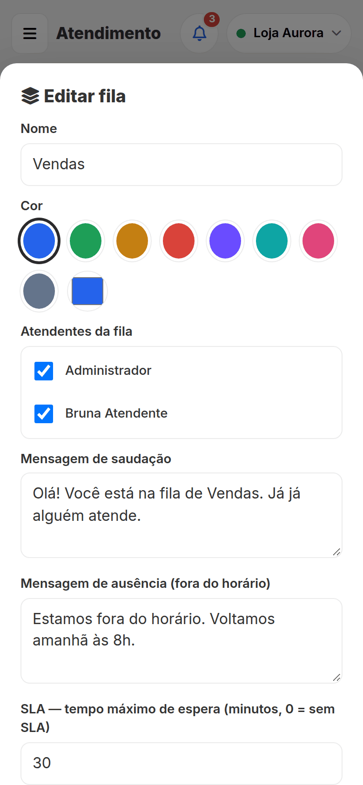

### Horário de atendimento da fila
> **Administrador**

1. No editor da fila, marque **Usar horário de atendimento**.
2. Para cada dia da semana (**Domingo** a **Sábado**), toque em **Faixa** e informe o horário de início e o horário de fim (até 4 faixas por dia). Dia sem faixa fica **fechado**.
3. Fora do horário, o cliente recebe a **Mensagem de ausência**.
4. Salve com **Salvar**.

## 5. Enviar

### Escolher o destinatário

A tela **Enviar** (botão **+** no meio da barra de baixo) manda mensagens para qualquer contato.

1. Em **Para quem?**, digite um nome da sua lista de contatos ou um número, como (82) 99999-0001. Aparecem sugestões enquanto você digita.
2. Toque numa sugestão para escolher, ou digite o número completo.
3. Para limpar, toque no X ao lado do campo.
4. A linha **Sua mensagem sairá assinada** mostra o nome que vai na assinatura.

> **Dica:** o rascunho é guardado: se você sair da tela, o destinatário e o texto voltam quando retornar.

### Verificar se o número tem WhatsApp

1. Depois de escolher o destinatário, toque em **Verificar número**.
2. O painel mostra se o número existe no WhatsApp e qual é o nome dele.

> **Atenção:** este botão só aparece para quem tem permissão de verificar números.

### Enviar texto

1. Na aba **Texto**, escreva em **Mensagem** (até 4096 caracteres; o contador mostra quanto falta).
2. Se quiser, ligue **Mostrar "digitando…" antes de enviar** e escolha 2, 3, 5 ou 8 segundos.
3. Confira a **Pré-visualização** do balão.
4. Toque em **Enviar**. A tela mostra **Enviada!** com as opções **Enviar outra** e **Abrir conversa**.
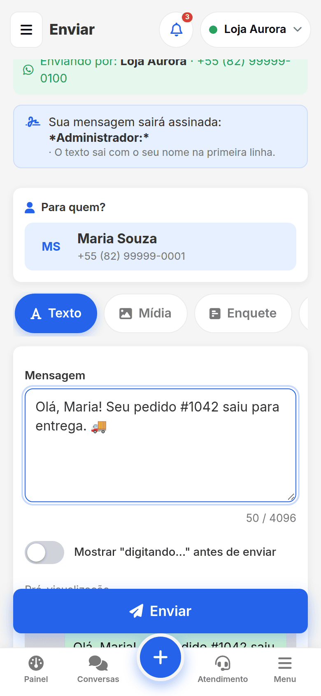

### Enviar mídia

1. Abra a aba **Mídia**.
2. Toque em **Arquivo** (ou **Câmera**, no celular) e escolha imagem, vídeo, áudio, PDF, Word, Excel, TXT ou ZIP, até 25 MB.
3. Escreva uma **Legenda (opcional)**.
4. Toque em **Enviar**; uma barra de progresso acompanha o envio.
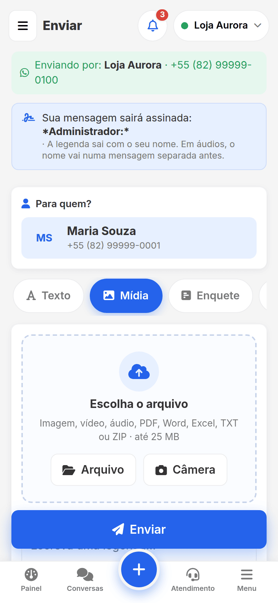

### Enviar enquete

1. Abra a aba **Enquete**.
2. Escreva a **Pergunta** e preencha de 2 a 12 opções; use **Adicionar opção** para criar mais.
3. Ligue **Permitir várias respostas** se quiser.
4. Toque em **Enviar**.
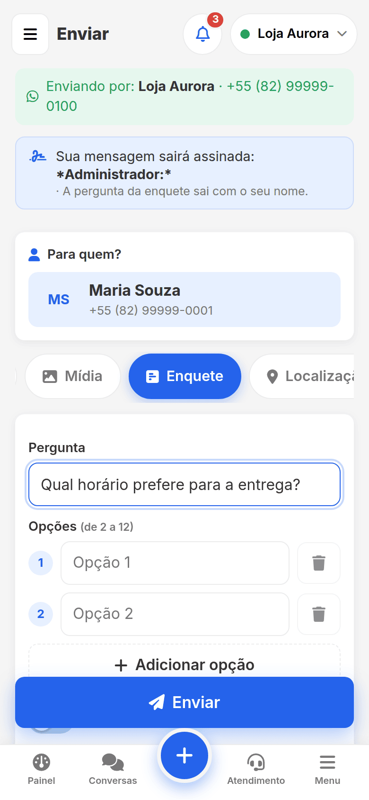

> **Dica:** opções repetidas ou vazias são recusadas, com a mensagem indicando o que corrigir.

### Enviar localização

1. Abra a aba **Localização**.
2. Toque em **Usar minha localização** ou digite **Latitude** e **Longitude**.
3. Preencha o **Nome do local (opcional)** e o **Endereço (opcional)**. O link **Ver no mapa** ajuda a conferir.
4. Toque em **Enviar**.
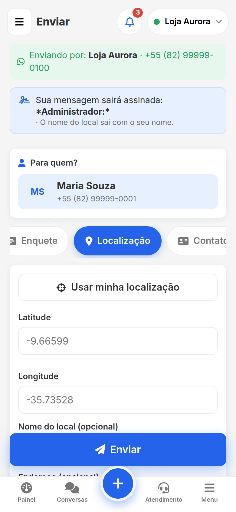

### Enviar contato

1. Abra a aba **Contato**.
2. Informe o **Nome do contato** e o **Número do contato** (com DDD).
3. Toque em **Enviar**. O destinatário recebe um cartão de contato que pode salvar.
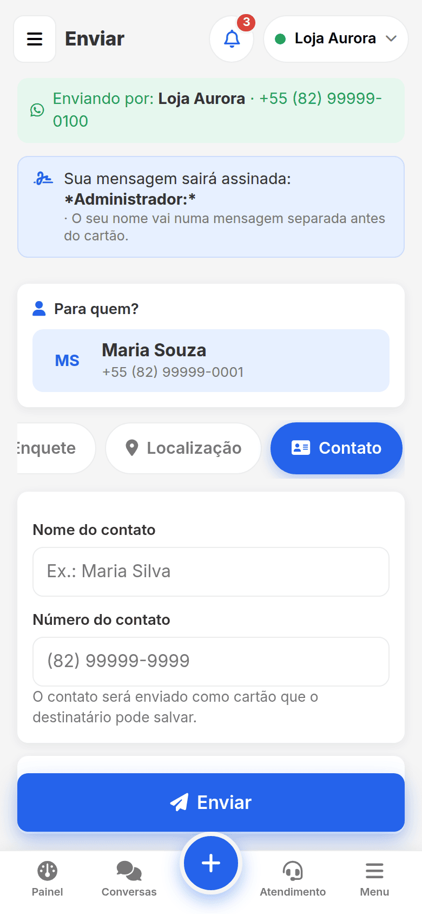

### Agendar o envio

Em vez de enviar agora, você pode marcar um dia e hora.

1. Ligue o interruptor **Agendar**.
2. Escolha a **Data e hora** (pelo menos 1 minuto à frente, no fuso do seu aparelho).
3. O botão muda para **Agendar**; toque nele. O painel avisa **Mensagem agendada!** e oferece **Ver agendadas**.
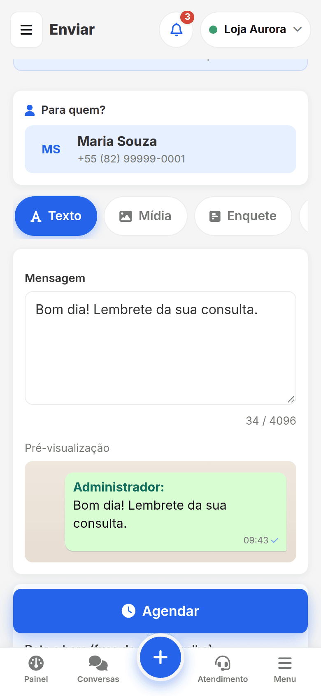

> **Atenção:** só dá para agendar mensagens de **Texto** e **Mídia**. A assinatura com o seu nome é gravada no agendamento.

## 6. Agendadas

### Acompanhar as mensagens agendadas

1. Abra **Agendadas** no menu.
2. Os filtros **Pendentes**, **Enviadas**, **Com erro**, **Canceladas** e **Todas** mostram a contagem de cada grupo.
3. Cada cartão mostra o contato, o dia e a hora, o texto e a assinatura com que vai sair.
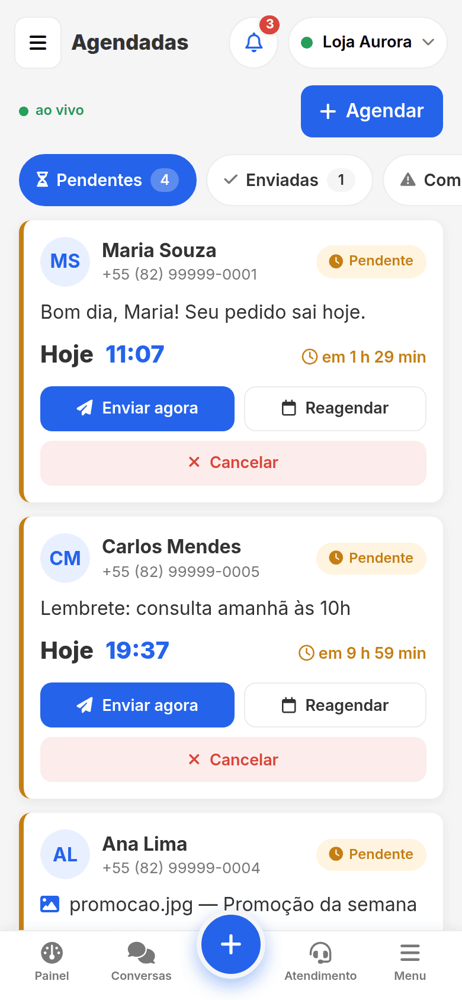
4. Toque em **Agendar** (canto superior) para criar um agendamento novo; você vai para a tela **Enviar**.

> **Dica:** o servidor envia as agendadas a cada minuto, no máximo cinco por rodada.

### Enviar agora, reagendar ou cancelar

1. Em uma mensagem **pendente**, toque em **Enviar agora** para mandar na hora, **Reagendar** para mudar o horário ou **Cancelar** para desistir.
2. Em **Reagendar**, escolha **Nova data e hora** ou use os atalhos **+30 min**, **+1 h** e **Amanhã 9h**, e toque em **Reagendar**.
3. Mensagens com erro têm **Tentar enviar**; as canceladas podem ser reagendadas.

> **Atenção:** cancelar uma agendada não pode ser desfeito, mas você pode reagendá-la depois.

## 7. Automações

### O que são automações

Uma automação responde ou age sozinha quando acontece algo: **Quando** (gatilho) e **Então** (ações), com condições opcionais no meio.

1. Abra **Automações** no menu.
2. A aba **Automações** lista as regras e a aba **Registros** mostra o histórico do que cada uma fez.
3. A ordem importa: as regras são avaliadas de cima para baixo. Use as setas para reordenar e a ação **Parar aqui** para impedir que as de baixo também respondam.
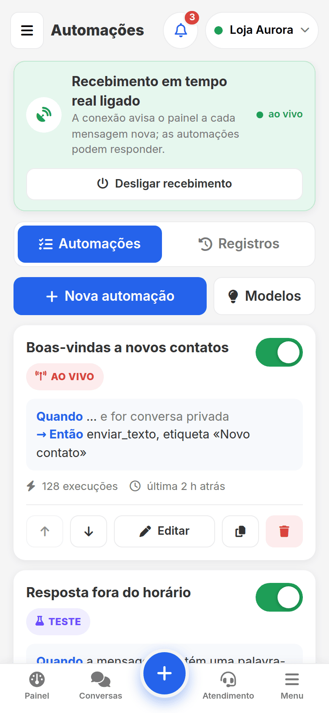

> **Atenção:** automações dependem do recebimento em tempo real (veja "Ligar o recebimento em tempo real", logo adiante).

### Criar uma automação a partir de um modelo
> **Administrador**

1. Toque em **Modelos** (ou escolha um modelo na tela vazia): **Resposta de ausência**, **Boas-vindas** ou **Preço**.
2. O editor abre já preenchido. Ajuste o texto e siga os passos do assistente.

### Escolher o gatilho (Quando)
> **Administrador**

1. Toque em **Nova automação**. O passo 1 é **Gatilho**.
2. Dê um nome em **Nome da automação** e escolha **Quando ela deve começar?**:
   - **Mensagem recebida:** quando o contato escrever certas palavras (defina **Palavras-chave** e **Como comparar?**).
   - **Primeira mensagem do contato:** só na primeira vez que a pessoa fala com você.
   - **Primeira mensagem do dia:** na primeira mensagem de cada pessoa em cada dia.
   - **Qualquer mensagem:** toda mensagem recebida.
   - **Agendado:** em dias e horários marcados.
   - **Conexão desconectada:** quando o WhatsApp cair (você escolhe números para avisar).
3. Defina o **Limite de respostas por contato/hora** para evitar respostas em excesso (padrão 3).
4. Toque em **Continuar**.
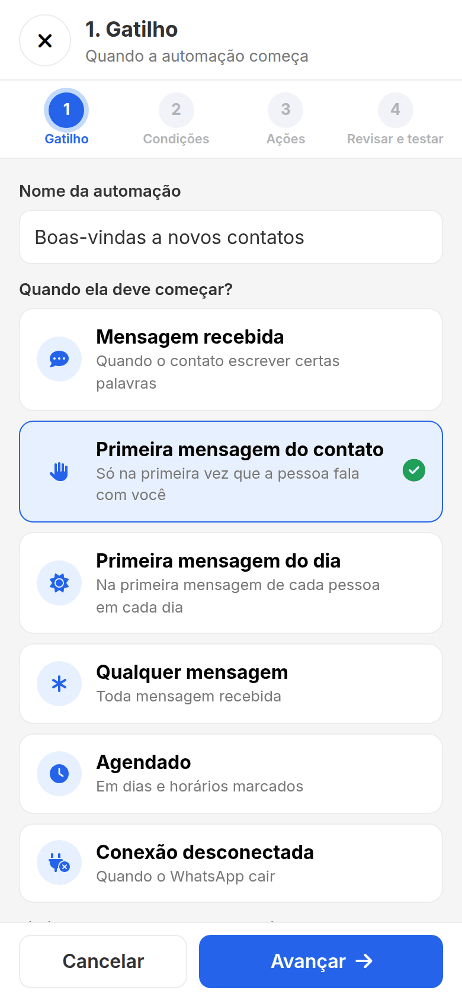

### Definir as condições
> **Administrador**

O passo 2, **Condições**, é opcional: sem condições, a regra vale para todas as mensagens do gatilho.

1. Escolha o **Tipo de conversa**: **Privada**, **Grupos** ou **As duas**.
2. Em **Horário de funcionamento**, escolha **Qualquer hora**, **Dentro do horário** ou **Fora do horário** e informe **Abre às**, **Fecha às** e os **Dias de funcionamento**.
3. Em **Contato**, escolha **Qualquer um**, **Só contato novo** ou **Só quem já falou**.
4. Marque o **Tipo de mensagem** (texto, imagem, áudio etc.; nenhum marcado = todos).
5. Use **Só estes contatos** e **Nunca para estes contatos** (um número por linha) para limitar ou excluir pessoas.

### Escolher as ações (Então)
> **Administrador**

No passo 3, **Ações**, você monta o que a automação faz, em ordem.

1. Toque em **Adicionar ação** e escolha entre: **Responder com texto**, **Responder com mídia**, **Esperar**, **Marcar como lida**, **Chamar um webhook**, **Enviar para uma fila**, **Colocar etiqueta** e **Parar aqui**.
2. Nos textos, use as variáveis **{nome}**, **{numero}**, **{data}**, **{hora}** e **{saudacao}**.
3. Use o **Atraso antes desta ação** para a resposta parecer humana.
4. Reordene com as setas ou remova com o X.

> **Atenção:** as esperas e atrasos somam, no máximo, 45 segundos.

### Testar no simulador
> **Administrador**

O passo 4, **Revisar e testar**, tem o **Simulador**: você vê o que a regra faria, sem enviar nada.

1. Em **Se o contato enviar:**, escreva uma mensagem de exemplo.
2. Marque, se quiser, **Grupo**, **Contato novo** ou **Fora do horário**.
3. Toque em **Simular**. O painel lista cada etapa e se a regra casaria ou não.
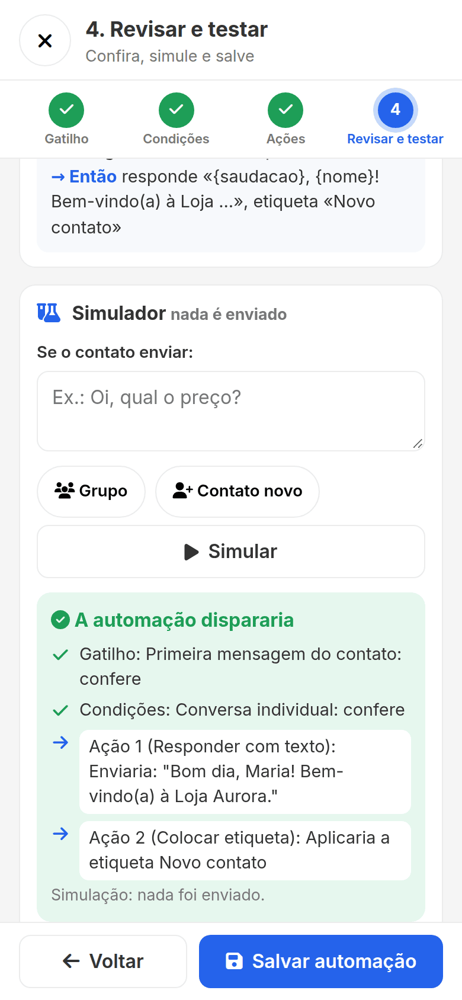

### Modo TESTE ou AO VIVO
> **Administrador**

1. No passo 4, escolha o **Modo**:
   - **TESTE:** avalia e registra, mas NÃO envia nada.
   - **AO VIVO:** responde pessoas de verdade.
2. Marque **Ligar a automação ao salvar** se quiser ativá-la já.
3. Toque em **Salvar**. Uma automação nova sempre começa desligada e em TESTE.
4. Na lista, toque no selo **TESTE**/**AO VIVO** para trocar o modo e use o interruptor para ligar e desligar.

> **Dica:** deixe em TESTE por um tempo e confira a aba **Registros**; só passe para AO VIVO quando estiver satisfeito.

### Ligar o recebimento em tempo real
> **Administrador**

1. No topo da tela Automações, o aviso informa **Recebimento em tempo real ligado** ou **desligado**.
2. Se estiver desligado, toque em **Ligar recebimento** e confirme. Para parar, **Desligar recebimento**.
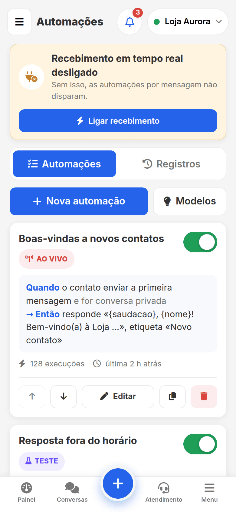

> **Atenção:** o painel nunca liga isso sozinho. Sem ele, as automações por mensagem não disparam.

### Acompanhar os registros

1. Abra a aba **Registros**.
2. Filtre por **Todos**, **Executou**, **Ignorou**, **Erro** ou **Teste**.
3. Cada linha mostra a automação, o número, a hora e o detalhe do resultado. Toque em **Carregar mais** para ver o histórico antigo.

### Duplicar e excluir
> **Administrador**

1. Na lista, toque no ícone de copiar para duplicar (a cópia nasce desligada, em TESTE).
2. Toque na lixeira para excluir e confirme.

## 8. Chatbot

### O que é o chatbot

O chatbot conversa com o cliente por etapas (menu, perguntas, transferência para atendente). É um fluxo montado por você.

1. Abra **Chatbot** no menu.
2. As abas são **Fluxos**, **Sessões** (clientes conversando agora) e **Registros** (cada passo do robô).
3. O banner no alto mostra se o **Recebimento em tempo real** está ligado; sem ele o chatbot não recebe mensagens. Toque em **Ligar recebimento** (ou **Desligar**).
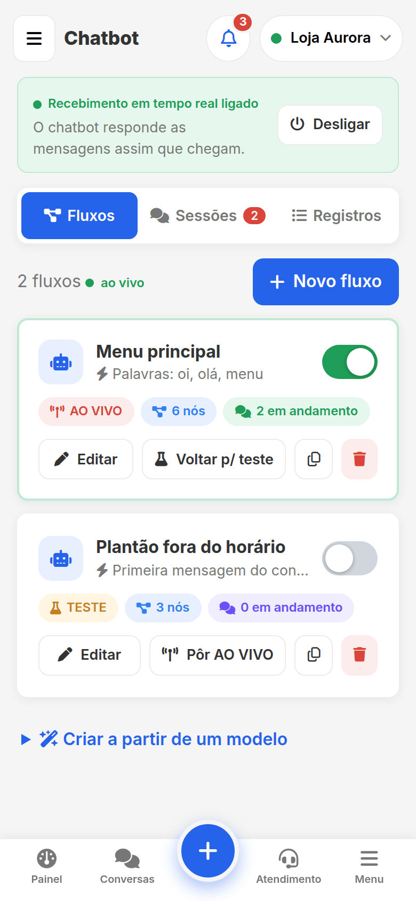

> **Atenção:** o chatbot só responde de verdade quando o fluxo está **ativo** e em **AO VIVO**.

### Criar um fluxo a partir de um modelo
> **Administrador**

1. Na tela vazia (ou em **Criar a partir de um modelo**), escolha **Menu de atendimento**, **Horário e endereço** ou **Orçamento**.
2. O editor abre com as etapas prontas. Ajuste os textos.

### Montar as etapas do fluxo
> **Administrador**

1. Toque em **Novo fluxo** e dê um **Nome do fluxo**.
2. Em **Quando começa**, escolha **Primeira mensagem do contato**, **Palavras-chave** (separe por vírgula) ou **Toda mensagem sem atendimento**.
3. Na aba **Fluxo**, toque em **Adicionar** e escolha a etapa: **Mensagem**, **Menu**, **Pergunta**, **Transferir**, **Encerrar** ou **Webhook**.
   - **Menu:** o cliente responde com o número da opção; cada opção leva a uma etapa.
   - **Pergunta:** guarda a resposta numa variável (por exemplo, nome) que você usa depois como {{nome}}.
   - **Transferir:** passa para um atendente na fila escolhida.
4. Em cada etapa escolha **Depois disso, ir para** a próxima etapa.
5. A aba **Mapa** mostra uma visão geral; etapas inalcançáveis ficam em âmbar e precisam ser ligadas ou excluídas.
6. Ajuste as regras gerais: **Mensagem quando o cliente responde algo inválido**, **Tentativas inválidas permitidas**, **Ao exceder as tentativas** (**Transferir para atendente** ou **Encerrar a conversa**) e **Expirar a sessão após (minutos sem resposta)**. Também é possível limitar ao horário comercial.
7. Toque em **Salvar fluxo**.
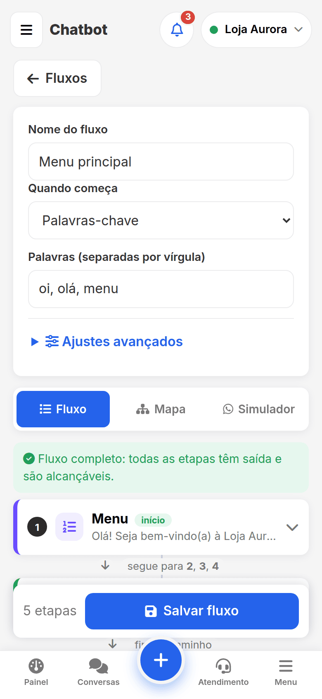

### Testar no simulador

1. No editor, abra a aba **Simulador**.
2. Digite no campo **Digite como o cliente…** e envie; o robô responde como responderia no WhatsApp.
3. Toque em **Reiniciar** para recomeçar a conversa.
4. Se mudou o fluxo, toque em **Salvar e simular**.
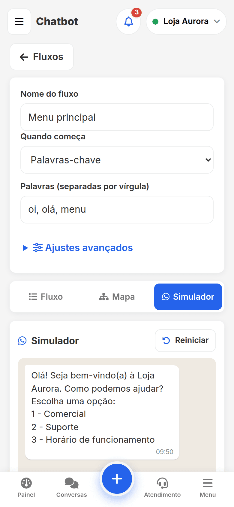

> **Dica:** é uma simulação interna: nada é enviado a ninguém.

### Ativar, modo TESTE x AO VIVO
> **Administrador**

1. Na lista de fluxos, use o interruptor para ativar ou desativar.
2. Toque em **Pôr AO VIVO** para responder clientes de verdade, ou em **Voltar p/ teste** para só registrar.
3. Use **Duplicar** (a cópia nasce inativa e em teste) ou a lixeira para excluir.

### Acompanhar as sessões

1. Na aba **Sessões**, veja os clientes que estão num fluxo agora.
2. Toque no ícone de conversa para abrir o chat, ou em **Encerrar** para finalizar a sessão.
3. Na aba **Registros** aparece cada passo do robô.

> **Dica:** o cliente pode digitar "sair", "encerrar" ou "cancelar" para sair do fluxo.

## 9. Campanhas e listas

### Antes de começar: limites anti-bloqueio

Campanha é o envio de uma mesma mensagem para muitas pessoas de uma lista. O WhatsApp pode bloquear números que mandam muitas mensagens iguais depressa demais.

1. Use apenas listas de pessoas que esperam receber a sua mensagem.
2. Comece com poucas mensagens por dia em números novos.
3. Prefira o perfil **Seguro**, que espera de 20 a 60 segundos entre mensagens e limita a 200 por dia.

> **Atenção:** o envio em massa pode fazer o WhatsApp banir o número. O painel pede confirmação extra antes de iniciar.


### Criar uma lista de contatos

1. Abra **Campanhas** e toque na aba **Listas**.
2. Toque em **Nova lista**, escreva o **Nome da lista** (por exemplo, "Clientes de Maceió") e toque em salvar.
3. Toque na lista para abrir. O topo mostra o total de contatos e quantos pediram para sair (opt-out).
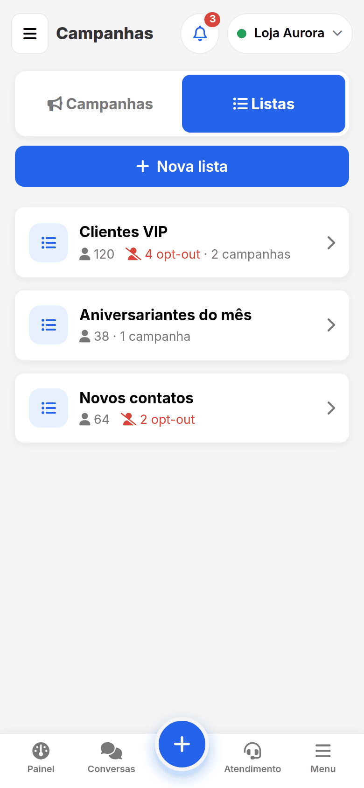

### Adicionar contatos à lista

1. Dentro da lista, toque em **Importar** (**Adicionar contatos**).
2. Na aba **Colar**, cole uma linha por contato no formato `nome; número` (por exemplo `Maria Souza; 82999990001`), ou carregue um arquivo CSV de até 2 MB.
3. A revisão mostra quantos são válidos, inválidos e duplicados. Marque os que quer manter.
4. Na aba **Contatos**, busque na sua agenda e marque quem deseja incluir.
5. Confirme com o botão de adicionar. Para tirar alguém, toque no X ao lado do nome.
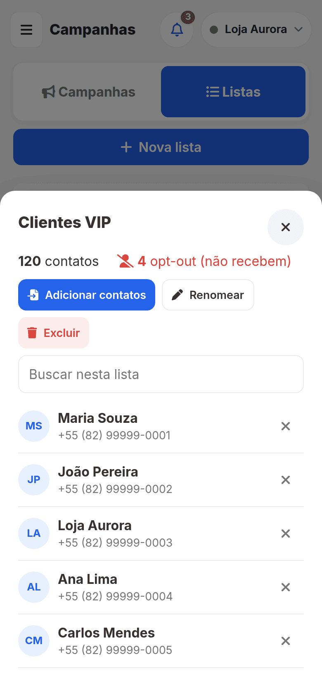

### Opt-out (quem pede para sair)

1. Quem responder uma campanha com **SAIR**, **PARAR**, **PARE**, **STOP**, **DESCADASTRAR** ou frases como "quero sair" é marcado como opt-out.
2. Esses contatos aparecem com marcação própria na lista e **nunca mais recebem** campanhas daquela conexão.
3. A contagem **não receberão (opt-out)** aparece ao escolher a lista.

> **Atenção:** isso depende do recebimento em tempo real ligado.

### Criar uma campanha (assistente em 4 passos)

1. Na aba **Campanhas**, toque em **Nova campanha**.
2. **Passo 1, Escolha a lista:** toque na lista de destino.
3. **Passo 2, Escreva a mensagem:** dê o **Nome da campanha (só você vê)** e escolha entre **Texto** e **Mídia** (arquivo de até 16 MB, com legenda). Use os botões **{nome}** e **{primeiro_nome}** para personalizar. Veja que a mensagem sai assinada com o seu nome.
4. **Passo 3, Limites anti-bloqueio:** escolha **Seguro**, **Moderado** ou **Rápido** (marcado como arriscado), ou ajuste o **Intervalo entre mensagens (segundos)**, o **Limite por dia (mensagens)** e a **Janela de horário**. A estimativa mostra quanto tempo vai levar.
5. **Passo 4, Revisar e iniciar:** confira o resumo e o balão de pré-visualização. Toque em **Salvar rascunho** para guardar ou em **Revisar e iniciar…**.
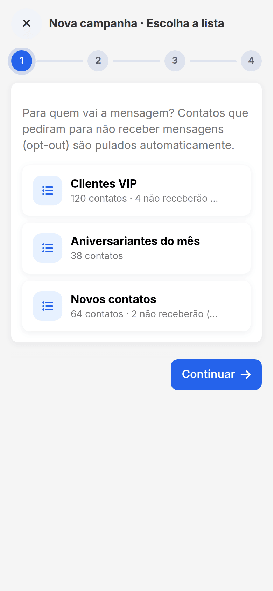

### Confirmar e iniciar o envio

1. Ao tocar em **Revisar e iniciar…**, aparece **Confirmar envio em massa**, com o aviso de risco de bloqueio.
2. Digite o número total de destinatários mostrado na tela. O botão só libera quando o número confere.
3. Toque em **Iniciar envio**. O painel avisa **Campanha iniciada! Acompanhe o envio ao vivo.**

> **Dica:** quem não tem a permissão de iniciar pode apenas salvar rascunhos.

### Acompanhar, pausar e cancelar

1. Na lista de campanhas, cada cartão mostra **enviados**, **falhas**, **na fila** e **pulados**; toque num número para ver os destinatários daquele grupo.
2. Use **Pausar**, **Retomar** ou **Cancelar** durante o envio. **Editar** e **Excluir** ficam disponíveis em rascunhos, concluídas e canceladas.
3. Se o limite do dia for atingido, o envio pausa e continua no dia seguinte, dentro da janela de horário.

## 10. Contatos, grupos, respostas rápidas, etiquetas e notas

Esta seção reúne as telas de cadastro e organização: quem você atende (Contatos e Grupos) e as ferramentas que agilizam o dia a dia (Respostas rápidas, Etiquetas e Notas).

### Buscar contatos e iniciar uma conversa

Na tela **Contatos** você vê todos os contatos da conexão escolhida, em ordem alfabética, com rolagem infinita.

1. No menu, abra **Contatos**.
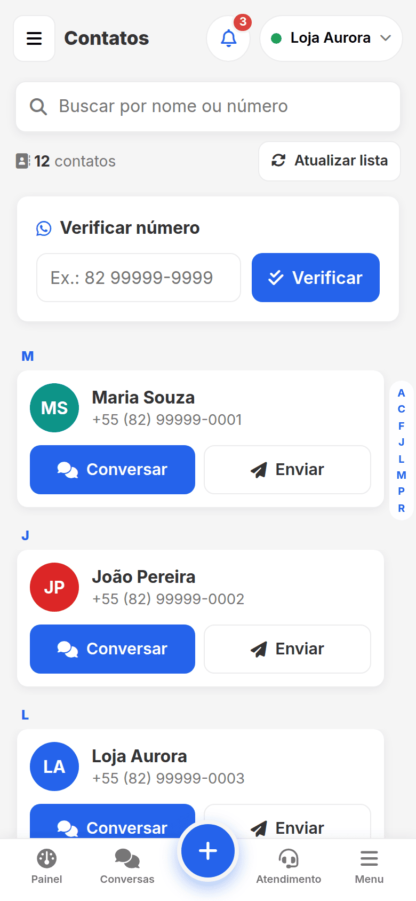
2. Digite no campo **Buscar por nome ou número**. A busca acontece sozinha, depois de uma pequena pausa na digitação. Toque no **X** para limpar.
3. Sem busca, use o índice de letras na lateral direita para pular direto para uma letra.
4. Toque em **Conversar** para abrir a conversa com a pessoa, ou em **Enviar** para abrir a tela Enviar já com o destinatário preenchido.
5. Se a lista estiver desatualizada, toque em **Atualizar lista**. O total de contatos aparece ao lado.

> **Dica:** os botões **Conversar** e **Enviar** só aparecem se o seu usuário tiver essas permissões.

### Verificar se um número tem WhatsApp

O cartão **Verificar número** consulta o WhatsApp para saber se um número existe, sem enviar nada para a pessoa.

1. Em **Contatos**, localize o cartão **Verificar número**.
2. Digite o número com DDD, por exemplo `82 99999-0001`. Se você digitar só DDD e número, o painel acrescenta o 55 do Brasil sozinho.
3. Toque em **Verificar**.

4. Se o número tiver WhatsApp, aparecem o nome (quando houver), o número formatado e os botões **Conversar** e **Enviar**. Se não tiver, aparece "Este número não tem WhatsApp".

> **Atenção:** números com menos de 10 dígitos são recusados com a mensagem pedindo o DDD.

### Ver grupos e copiar o link de convite

A tela **Grupos** é somente de leitura: mostra os grupos do WhatsApp conectado e seus participantes. Não é possível criar grupos, sair deles nem remover pessoas por aqui.

1. No menu, abra **Grupos**.
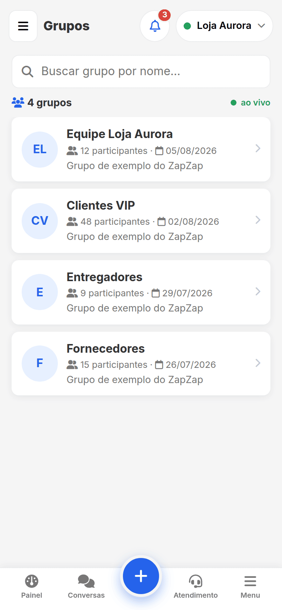
2. Use **Buscar grupo por nome…** para filtrar. A lista se atualiza sozinha a cada minuto (selo **ao vivo**).
3. Toque em um grupo para abrir o detalhe.
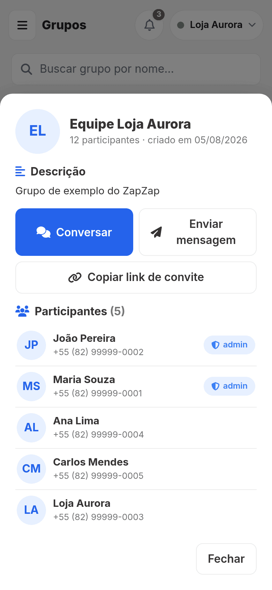
4. No detalhe você vê a descrição, o número de participantes e a lista deles, com o selo **admin** para quem administra. Quando há 8 ou mais participantes aparece o campo **Buscar participante…**.
5. Toque em **Conversar** ou **Enviar mensagem** para falar com o grupo.
6. Toque em **Copiar link de convite** para copiar o link. Se você não for administrador do grupo, o WhatsApp pode negar o link.

> **Dica:** sem a permissão de convite, o botão é substituído por um aviso com cadeado.

### Criar respostas rápidas

Respostas rápidas são textos prontos (com atalho) para as mensagens que você repete todo dia.

1. No menu, abra **Respostas rápidas**.
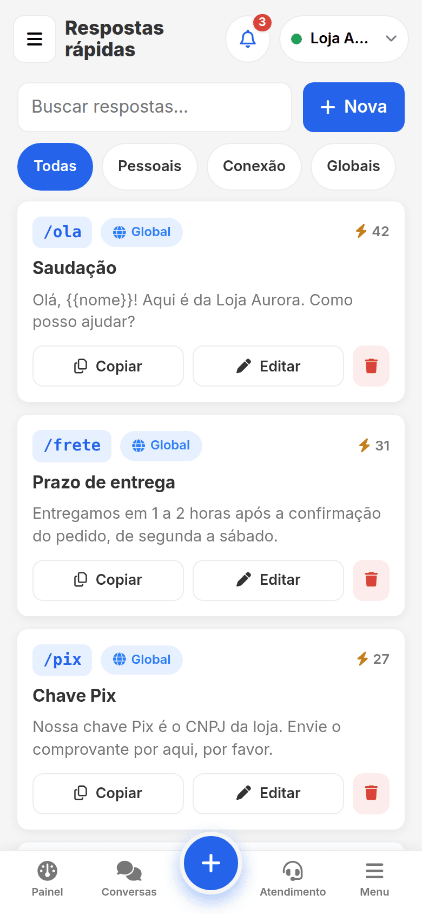
2. Toque em **Nova**. Se a lista estiver vazia, você também pode tocar num dos exemplos prontos (como **Saudação** ou **Horário de funcionamento**) para começar com o texto preenchido.
3. Preencha o **Atalho** (sem a barra; só letras, números, `_` e `-`), o **Título** e o **Texto**.
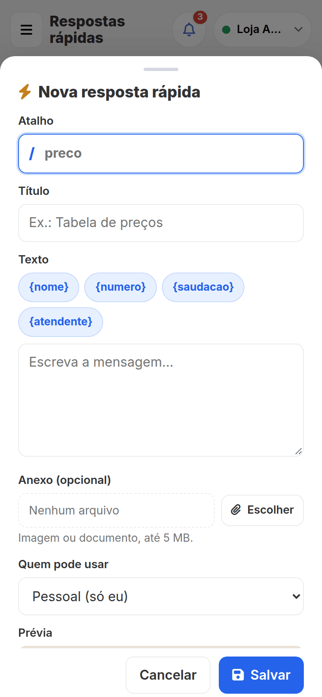
4. Para personalizar, toque nas variáveis acima do texto: `{nome}`, `{numero}`, `{saudacao}` (bom dia, boa tarde ou boa noite) e `{atendente}` (o seu nome). A **Prévia** mostra como a mensagem vai ficar.
5. Se quiser, anexe uma imagem ou documento (até 5 MB) em **Anexo (opcional)**.
6. Em **Quem pode usar**, escolha **Pessoal (só eu)**, **Esta conexão** ou **Global (todas)**. As duas últimas exigem permissão de editar respostas.
7. Toque em **Salvar**.

> **Dica:** use os filtros **Todas**, **Pessoais**, **Conexão** e **Globais** para achar rápido. Em cada cartão há **Copiar**, **Editar** e a lixeira (com confirmação).

### Usar uma resposta rápida numa conversa

1. Abra uma conversa em **Conversas**.
2. No campo de mensagem, digite `/` seguido do começo do atalho, ou toque no ícone de raio.
3. Escolha a resposta na lista, que tem busca por atalho, título e texto. As variáveis são preenchidas com os dados do contato.
4. Revise o texto no campo de mensagem e envie.

> **Atenção:** é preciso ter a permissão de usar respostas rápidas; sem ela o painel avisa com uma mensagem.

### Organizar com etiquetas

Etiquetas são marcadores coloridos para classificar conversas (por exemplo, "Cliente VIP").

1. No menu, abra **Etiquetas e notas** e fique na aba **Etiquetas**.

2. Toque em **Nova etiqueta**, escreva o **Nome**, escolha uma das 12 cores e confira a **Prévia**. Toque em **Salvar**.
3. Cada cartão mostra quantas conversas usam a etiqueta. Toque na contagem para ver a lista de conversas e abrir uma delas.
4. Use **Editar** para renomear ou trocar a cor, e **Excluir** para apagar (o painel pede confirmação).
5. Para aplicar numa conversa, abra a conversa e toque no botão de etiquetas. Marque as que valem para o contato; também é possível criar uma etiqueta nova ali mesmo, em **Nova etiqueta…** e **Criar**.

> **Dica:** quem só tem permissão de ver etiquetas enxerga as marcações, mas não consegue criar nem aplicar.

### Registrar notas internas

Notas são anotações da equipe sobre um contato. A pessoa atendida nunca as recebe.

1. Dentro de uma conversa, toque no botão de notas.

2. Escreva em **Escreva uma nota interna…** (até 2000 caracteres) e toque em adicionar.
3. Use **Fixar** para deixar uma nota importante no topo (e **Desafixar** para tirar), ou a lixeira para excluir, com confirmação.
4. Para ver as notas mais recentes de todas as conversas, abra **Etiquetas e notas** e toque na aba **Notas recentes**.

## 11. Relatórios

> **Administrador**

A tela **Relatórios** reúne números de envios, mensagens e atendimentos de um período. Exige a permissão de ver relatórios.

### Ler os números do período

1. No menu, abra **Relatórios**.

2. Escolha o período: **Hoje**, **7 dias**, **30 dias**, **Mês** ou **Personalizado** (neste caso, preencha **De** e **Até**).
3. Veja os cartões de indicadores: mensagens enviadas e recebidas, atendimentos, atendimentos resolvidos, falhas de envio, campanhas enviadas e tempo médio da 1ª resposta. Cada cartão mostra a variação em relação ao período anterior.
4. Toque em um cartão para abrir os detalhes, com gráfico diário e tabela de valores.

> **Dica:** alguns cartões só aparecem quando o recurso correspondente (atendimento, campanhas) está disponível na conexão.

### Gráfico, ranking e horários de pico

1. Em **Mensagens por dia**, alterne entre **barras** e **linhas** nos botões do canto. Azul = enviadas, verde = recebidas. A tabela abaixo traz os mesmos valores em texto.
2. Em **Origem dos envios**, veja quanto saiu do Painel, Agendadas, Automações, Chatbot, Filas, Campanhas e API.
3. Em **Ranking por usuário** e **Ranking por fila**, compare quem mais atendeu e o desempenho de cada fila.
4. Em **Horários de pico**, toque numa célula do mapa de calor para ver quantas mensagens houve naquele dia da semana e hora.


### Exportar relatórios em CSV

1. Toque em **Exportar CSV** (precisa da permissão de exportar).
2. Escolha o relatório: **Envios (lista completa)**, **Mensagens por dia**, **Por usuário**, **Por fila**, **Horários de pico** ou **Atendimentos**. O período usado é o que está selecionado na tela.
3. O arquivo é baixado e abre em planilhas como Excel ou Google Planilhas.

## 12. Histórico

O **Histórico** é o registro de todo envio feito pelo painel e pelas mensagens agendadas.

### Consultar e filtrar envios

1. No menu, abra **Histórico**.

2. No topo, os cartões mostram **Envios**, **Com sucesso**, **Com erro** e **Hoje**.
3. Use **Buscar por texto, número ou erro** para procurar.
4. Refine com os filtros: **Origem** (**Todos**, **Painel**, **Agenda**), **Resultado** (**Todos**, **Sucesso**, **Erro**) e **Período** (**Todo o período**, **Só hoje**).
5. Toque em **Carregar mais** para ver envios antigos. A lista se atualiza sozinha a cada 10 segundos (selo **ao vivo**).

### Ver se a mensagem foi entregue e lida

1. Em um envio com sucesso, toque em **Ver status**.
2. O painel consulta o WhatsApp e mostra se a mensagem está **Enviando…**, **Enviada**, **Entregue** ou **Lida**.

> **Dica:** envios com erro mostram o motivo na própria linha, o que ajuda a descobrir o problema (número inválido, conexão caída etc.).

### Exportar o histórico

1. Toque em **Exportar CSV** (barra acima da lista).
2. O arquivo `zapzap-historico-AAAA-MM-DD.csv` é baixado.

> **Atenção:** sem a permissão de exportar, o botão aparece desativado com um cadeado.

## 13. Integrações (API e webhooks)

> **Administrador**

A tela **Integrações** permite que outros sistemas (loja virtual, sistema de pedidos, planilhas) usem o seu WhatsApp. Ela tem três abas: **Tokens**, **Webhooks** e **Como usar**. Exige a permissão de gerir tokens de API e webhooks.

### Criar um token de API

O token é a "chave" que o outro sistema usa. Cada token vale para uma conexão e só faz o que você marcar.

1. No menu, abra **Integrações** e fique na aba **Tokens**.

2. Toque em **Novo token**.
3. Preencha **Nome do token** (ex.: Meu sistema de pedidos) e escolha a **Conexão do WhatsApp**.
4. Em **O que este token pode fazer**, marque os escopos: **Enviar texto**, **Enviar mídia**, **Ver status** e **Ler mensagens**.
5. Defina o **Limite de requisições por minuto** (padrão 30, de 1 a 600) e a **Assinatura nas mensagens** (ex.: Loja Aurora).
6. Toque em **Criar token**.

7. Copie o token com **Copiar token** e guarde em local seguro. Ele aparece uma única vez; depois só fica visível o início dele.

> **Atenção:** toda mensagem enviada pela API sai assinada, na primeira linha, em negrito (por exemplo `*Loja Aurora:*`). Não dá para desligar.

### Acompanhar o uso e revogar um token

1. Na aba **Tokens**, cada cartão mostra a conexão, os escopos, a assinatura, o limite por minuto, o último uso e a quantidade de usos.
2. Toque em **Uso** para ver as chamadas recentes.
3. Se o token vazou ou não é mais necessário, toque em **Revogar**. Ele deixa de funcionar na hora.

### Chamar a API pública

A URL base é `https://SEU-DOMINIO/zapzap/api_publica.php?acao=…`. Envie o token no cabeçalho `X-API-Token` (ou `Authorization: Bearer`). As respostas são sempre JSON, com `{"ok": false, "msg": "..."}` quando há erro. Se passar do limite por minuto, a API responde HTTP 429 e informa em quantos segundos tentar de novo.

Enviar texto (escopo "Enviar texto"; de 1 a 4000 caracteres):

```
curl -X POST "https://SEU-DOMINIO/zapzap/api_publica.php?acao=enviar_texto" \
  -H "X-API-Token: zz_SEU_TOKEN_AQUI" \
  -H "Content-Type: application/json" \
  -d '{"numero":"5582999990001","texto":"Olá! Pedido confirmado."}'
```

Use o número só com dígitos, com DDI e DDD, por exemplo `5582999990001`. Resposta de sucesso: `{"ok":true,"msg_id":"...","numero":"..."}`.

Enviar mídia (escopo "Enviar mídia"): informe `numero`, `mime`, `nome` e **uma** das opções `url` (https público) ou `base64`. A legenda é opcional (até 1000 caracteres) e o arquivo pode ter até 25 MB.

```
curl -X POST "https://SEU-DOMINIO/zapzap/api_publica.php?acao=enviar_midia" \
  -H "X-API-Token: zz_SEU_TOKEN_AQUI" \
  -H "Content-Type: application/json" \
  -d '{"numero":"5582999990001","url":"https://exemplo.com/foto.jpg","mime":"image/jpeg","nome":"foto.jpg","legenda":"Olha só"}'
```

Ver se o WhatsApp está conectado (escopo "Ver status"):

```
curl -H "X-API-Token: zz_SEU_TOKEN_AQUI" \
  "https://SEU-DOMINIO/zapzap/api_publica.php?acao=status"
```

Listar mensagens de uma conversa (escopo "Ler mensagens"; `limite` de 1 a 50, padrão 20):

```
curl -H "X-API-Token: zz_SEU_TOKEN_AQUI" \
  "https://SEU-DOMINIO/zapzap/api_publica.php?acao=mensagens&jid=5582999990001&limite=10"
```

> **Dica:** abra `?acao=ajuda` (sem token) para ler a documentação resumida da API, e use a aba **Como usar** do painel para copiar exemplos em cURL, PHP e JavaScript.

### Receber avisos com webhooks de saída

Webhooks fazem o caminho inverso: o ZapZap avisa o seu sistema quando algo acontece.

1. Em **Integrações**, toque na aba **Webhooks** e em **Novo webhook**.

2. Preencha **Nome** e **URL que vai receber os avisos (https)**. Só endereços https públicos são aceitos; endereços internos são recusados.
3. Marque os **Eventos**: **Mensagem recebida**, **Mensagem enviada** e **Mudança de conexão**.
4. Deixe **Ligado** marcado (desligue para pausar sem excluir) e toque em **Salvar**.
5. O **segredo** do webhook é mostrado uma única vez; copie com **Copiar segredo**. Use-o para conferir a assinatura `X-ZapZap-Assinatura` (HMAC-SHA256 do corpo) em cada aviso recebido.
6. Toque em **Testar** para enviar um aviso de teste e ver o resultado (código HTTP e tempo). Em **Logs** você vê as entregas, com número de tentativas (o painel tenta até 2 vezes, 5 segundos cada).

O aviso chega como JSON no formato `{"evento":"mensagem_recebida","instancia":"...","ts":1790000000,"teste":false,"dados":{...}}`, com os cabeçalhos `X-ZapZap-Evento` e `X-ZapZap-Assinatura`.

> **Dica:** ao editar um webhook, marque **Gerar novo segredo** se quiser trocar o segredo; o antigo deixa de valer.

## 14. Usuários e permissões

> **Administrador**

A tela **Usuários** é exclusiva do administrador (master). Nela você cria as pessoas que usam o painel e define o que cada uma pode fazer e em quais conexões.

### Criar um usuário

1. No menu, abra **Usuários**.

2. Toque em **Novo usuário**. Use **Buscar por nome ou usuário** para achar alguém depois.
3. Preencha **Nome (aparece nas mensagens enviadas)**, **Usuário (login)** e **Senha** (mínimo de 6 caracteres).

4. Escolha as permissões (veja o próximo tópico) e as conexões liberadas.
5. Toque em **Salvar**. O botão só fica ativo quando há alterações; se tentar sair sem salvar, o painel pergunta se deseja descartar.

> **Atenção:** o nome do usuário é usado na assinatura de toda mensagem que ele enviar (`*Nome:*` na primeira linha). Escolha um nome que o cliente reconheça.

### Usar perfis rápidos e ajustar permissões

1. No editor, em **Permissões**, toque em um perfil rápido para marcar várias permissões de uma vez:
   - **Atendente**: conversas, envio de texto e mídia, respostas, filas, etiquetas e notas.
   - **Somente leitura**: só visualiza telas.
   - **Gerente**: quase tudo, exceto criar/excluir/desconectar conexões, API e reiniciar.
2. Depois ajuste item a item. As permissões são agrupadas (Conversas, Enviar, Agendadas, Contatos, Grupos, Histórico, Conexões, Configurações, Automações, Chatbot, Filas e atendimento, Campanhas, Respostas rápidas, Etiquetas e notas, Relatórios, Integrações, Auditoria, Versões). Cada grupo tem **Marcar tudo** e **Limpar**; no topo há **Marcar tudo** e **Limpar** gerais.
3. O contador mostra quantas permissões estão liberadas.

> **Dica:** um usuário master tem acesso total e não tem permissões para ajustar.

### Liberar conexões

1. No editor, na seção **Conexões liberadas**, marque **Todas as conexões** (inclusive as criadas depois) ou escolha uma a uma as que o usuário pode ver.
2. É obrigatório escolher ao menos uma conexão (ou marcar **Todas**).

> **Atenção:** o usuário só enxerga conversas, contatos e relatórios das conexões liberadas.

### Gerar ou redefinir a senha de um usuário

Por segurança, ninguém consegue ler a senha de outro usuário. A senha que você cria ou gera é definitiva; ela só aparece uma vez para você repassar.

1. Em **Usuários**, toque no usuário para abrir o detalhe.
2. Toque em **Gerar nova senha** e confirme: o painel cria uma senha aleatória.

3. Copie com **Copiar senha** ou **Copiar login + senha** e envie à pessoa por um canal seguro.
4. A senha só aparece agora. A senha antiga deixa de funcionar e as sessões abertas são encerradas.
5. Se preferir escolher você mesmo a senha, toque em **Redefinir senha** e digite a **Nova senha** (mínimo 6 caracteres).

> **Dica:** nas duas telas (e ao criar o usuário) existe a opção **Exigir que a pessoa troque a senha no primeiro acesso**. Ela vem desligada; ligue só se quiser que a pessoa crie uma senha própria na primeira entrada.

### Ver a atividade e as sessões de um usuário

1. No detalhe do usuário há três abas: **Atividade**, **Sessões** e **Permissões**.
2. Em **Atividade**, veja o que a pessoa fez. Os cartões **Hoje**, **7 dias** e **Último acesso** funcionam como filtros; também há busca, período (**Todo o período**, **Hoje**, **Últimos 7 dias**, **Últimos 30 dias** ou datas escolhidas), tipo de ação e **Exportar CSV**.

3. Em **Sessões**, veja onde a pessoa está conectada. **Encerrar todas** faz com que ela precise entrar de novo.
4. Em **Permissões**, veja as conexões liberadas e as permissões ativas.

### Desativar ou excluir um usuário

1. No detalhe, toque em **Desativar** para impedir o acesso sem apagar nada (as sessões abertas são encerradas). **Ativar** reverte.
2. Para apagar de vez, toque em **Excluir**, digite o texto de confirmação pedido e confirme de novo. O histórico de atividade pode ser mantido para auditoria.

> **Atenção:** você não pode desativar nem excluir a si mesmo.

## 15. Auditoria

> **Administrador**

A **Auditoria** responde "quem fez o quê, quando e de onde". O administrador vê todos os usuários; quem tem a permissão de auditoria, mas não é master, vê apenas as próprias atividades.

### Consultar o registro de atividades

1. No menu, abra **Auditoria**.

2. Os cartões no topo resumem por tipo: **Acessos**, **Envios**, **Configuração**, **Usuários**, **Conexões** e **Navegação**. Toque num cartão para filtrar.
3. Use **Buscar por usuário, IP ou detalhe** e as pílulas de tipo e de período (**Hoje**, **7 dias**, **30 dias**, **Tudo**, **Período…** com **De** e **Até**).
4. O administrador também pode filtrar por usuário. **Falhas** mostra só o que deu errado e **Limpar filtros** volta ao início.
5. Cada linha mostra a ação, o usuário, o IP, a conexão, se deu certo e um detalhe curto. O conteúdo das mensagens e as senhas nunca são gravados.
6. Toque em **Exportar CSV** para baixar o registro filtrado.

### Entender o alerta de falhas de login

1. Quando há várias tentativas de login falhas vindas do mesmo IP na última hora, aparece o aviso **Atenção: falhas de login repetidas**, com o IP e a hora da última tentativa.
2. Se o aviso for inesperado, troque as senhas dos usuários e gere novas senhas em **Usuários**.

> **Dica:** o próprio sistema bloqueia tentativas em excesso: depois de várias falhas seguidas o login fica indisponível por cerca de 15 minutos.

## 16. Configurações

A tela **Configurações** reúne a sua conta, o perfil do WhatsApp, o comportamento da conexão, a segurança e informações do sistema.

### Ajustar o comportamento da conexão

1. No menu, abra **Configurações**.

2. Em **Comportamento**, ligue ou desligue: **Rejeitar chamadas**, **Ignorar grupos**, **Sempre online**, **Marcar mensagens como lidas**, **Ver status dos contatos** e **Sincronizar histórico completo**.
3. Ao ligar **Rejeitar chamadas**, preencha a **Mensagem enviada a quem ligar**.
4. Toque em **Salvar comportamento** (o botão só ativa depois de uma mudança).

> **Atenção:** a conexão também pode ser usada por outro sistema ligado ao mesmo WhatsApp. As mudanças valem para todos que a usam.

### Mudar o nome e o recado do perfil

1. Em **Perfil**, edite **Nome do perfil** (até 25 caracteres) e toque em **Salvar**.
2. Edite o **Recado (status)** (até 139 caracteres) e toque no **Salvar** correspondente.

> **Dica:** exige a permissão de alterar o perfil; sem ela, os campos ficam bloqueados com um cadeado.

### Trocar a sua senha

1. Em **Segurança**, digite a **Senha atual**.

2. Digite a **Nova senha** (mínimo de 6 caracteres, diferente da atual) e repita em **Repetir nova senha**. O olho mostra ou oculta o texto.
3. Toque em **Trocar senha**.
4. As sessões abertas em outros aparelhos são encerradas; a atual continua.

### Instalar o app e forçar atualização

1. Em **Sobre**, veja a versão do painel e da Evolution API.
2. Toque em **Instalar aplicativo** para ver como adicionar o ZapZap à tela inicial.
3. Se algo parecer desatualizado, toque em **Forçar atualização agora**: o painel limpa o cache e recarrega.

### Reiniciar a conexão

1. Em **Conexão**, se o WhatsApp estiver desconectado, toque em **Gerar QR Code** e leia pelo celular (WhatsApp, Configurações, Aparelhos conectados, **Conectar um aparelho**).
2. **Reiniciar conexão** exige confirmação dupla, porque o WhatsApp fica fora do ar por alguns segundos.

> **Atenção:** sair da conta (botão **Sair** em **Minha conta**) encerra apenas a sessão do painel; não desconecta o WhatsApp.

### Consultar o histórico de versões

> **Administrador**

A tela **Versões** só aparece para o administrador (master). Ela também abre ao tocar na versão no rodapé do menu lateral.

1. Abra **Versões** pelo menu lateral.

2. Cada cartão mostra o número da versão (a atual traz o selo **atual**), a data, o título e a lista do que mudou.
3. Toque em "arquivo(s) alterado(s)" para ver quais arquivos foram modificados.

## 17. Dúvidas frequentes e solução de problemas

### O QR Code não aparece ou expirou

O QR só é gerado quando a conexão não está conectada, e vale por pouco tempo.

1. Abra **Conexões** (ou **Configurações**, na seção **Conexão**) e toque em **Conectar / Gerar QR** ou **Gerar QR Code**.
2. Se o QR expirar, gere outro.
3. No celular: WhatsApp, **Configurações**, **Aparelhos conectados**, **Conectar um aparelho**.
4. Se continuar sem aparecer, toque em **Tentar de novo**. Se a conexão já estiver conectada, o QR não é gerado.

> **Dica:** é preciso ter a permissão de gerar QR Code.

### A mensagem não chega ao destinatário

1. Em **Histórico**, procure o envio e veja se está com **Sucesso** ou **Erro**; o motivo aparece na linha.
2. Toque em **Ver status** para saber se está **Enviada**, **Entregue** ou **Lida**. "Enviada" sem "Entregue" costuma significar que o celular da pessoa está desligado ou sem internet.
3. Confira se a conexão está **WhatsApp conectado** (selo no topo da tela).
4. Em **Contatos**, use **Verificar número** para ver se o número tem WhatsApp.

### O número não tem o nono dígito

Em alguns números do Brasil o WhatsApp registra a conta sem o 9 extra. Você não precisa se preocupar: digite o número normalmente, com o 9. O sistema pergunta ao WhatsApp qual é o endereço real e usa o correto.

1. Digite o número com DDD, como `82 99999-0001`.
2. Use **Verificar número** para confirmar se existe.
3. Para responder, use sempre a conversa existente em **Conversas**.

### Aparece "sem permissão" ou falta uma tela no menu

1. Telas sem permissão não aparecem no menu. Se uma ação mostra a mensagem de falta de permissão, o seu usuário não pode usá-la.
2. Peça ao administrador para liberar a permissão em **Usuários**, no editor do seu usuário.
3. Se aparecer "Nenhuma conexão (WhatsApp) liberada para o seu usuário", falta liberar uma conexão em **Conexões liberadas**.

### Esqueci a minha senha

1. O painel não envia e-mail de recuperação. Peça ao administrador.
2. Ele abre **Usuários**, toca no seu usuário e em **Gerar nova senha** (ou **Redefinir senha**).
3. Entre com a senha nova. Se ele tiver marcado a opção de exigir troca, o painel pede que você crie uma senha própria na hora; se não, é só continuar e, se quiser, trocar depois em **Configurações**.

> **Atenção:** depois de muitas tentativas erradas o login é bloqueado por cerca de 15 minutos ("Muitas tentativas. Aguarde…"). Espere e tente de novo.

### Não escuto o som das notificações no iPhone

1. Toque no sino, no topo, e depois no ícone de ajustes (**Preferências**).
2. Confira se **Som** está ligado, o volume e o tom; toque em **Testar**.
3. No iPhone o som segue a chave de silencioso do aparelho, e o navegador não libera vibração. Tire o aparelho do silencioso.
4. Confira também se **Não perturbe** está ligado e quais tipos de aviso estão marcados em **Avisar sobre**.
5. Instalar o ZapZap na tela inicial (Compartilhar, **Adicionar à Tela de Início**) melhora o comportamento do app.

### O painel pediu para atualizar sozinho

Toda vez que uma nova versão é publicada, o painel detecta e atualiza sozinho: aparece o aviso "Atualizando…" e a página recarrega em instantes. Nada precisa ser feito. Se ficar preso numa versão antiga, vá em **Configurações**, **Sobre**, **Forçar atualização agora**.

### Desconectei sem querer ou a conexão ficou vermelha

1. O selo no topo mostra **Desconectado** quando o WhatsApp está fora do ar.
2. Abra **Conexões** ou **Configurações**, gere um novo QR Code e leia pelo celular.
3. Se o WhatsApp voltou a conectar, o selo volta a ficar verde.

## 18. Glossário

### Glossário

- **Administrador (master):** usuário com acesso total, inclusive a Usuários, Auditoria e Versões.
- **API pública:** forma de outros sistemas enviarem mensagens e consultarem o WhatsApp usando um token.
- **Assinatura:** nome em negrito na primeira linha de toda mensagem enviada por um usuário ou token (`*Nome:*`).
- **Atendimento:** conversa em fila, que pode estar aguardando, em atendimento ou resolvida.
- **Auditoria:** registro de quem fez o quê, quando e de onde.
- **Conexão:** um número de WhatsApp ligado ao painel. Também chamada de instância.
- **CSV:** arquivo de planilha simples, que abre no Excel ou Google Planilhas.
- **Escopo:** permissão de um token de API (enviar texto, enviar mídia, ver status, ler mensagens).
- **Etiqueta:** marcador colorido aplicado a conversas.
- **JID:** identificador interno de uma conversa no WhatsApp (número ou grupo).
- **Nota interna:** anotação da equipe sobre um contato; o contato nunca a recebe.
- **Permissão:** autorização individual de um usuário para uma ação ou tela.
- **Perfil rápido:** conjunto de permissões pronto (Atendente, Somente leitura, Gerente).
- **QR Code:** imagem que o WhatsApp do celular lê para conectar o número ao painel.
- **Resposta rápida:** texto pronto, chamado por um atalho com `/`.
- **Segredo (webhook):** código usado para conferir que um aviso veio mesmo do ZapZap.
- **Sessão:** acesso aberto de um usuário em um aparelho. Dura até 30 dias ou até ser encerrada.
- **Token:** chave de acesso da API pública, mostrada uma única vez ao ser criada.
- **Webhook de saída:** aviso automático que o ZapZap envia ao seu sistema quando algo acontece.
